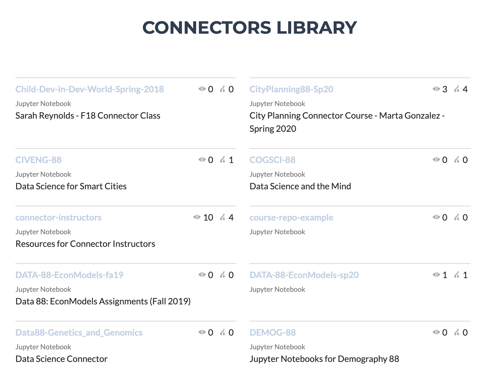
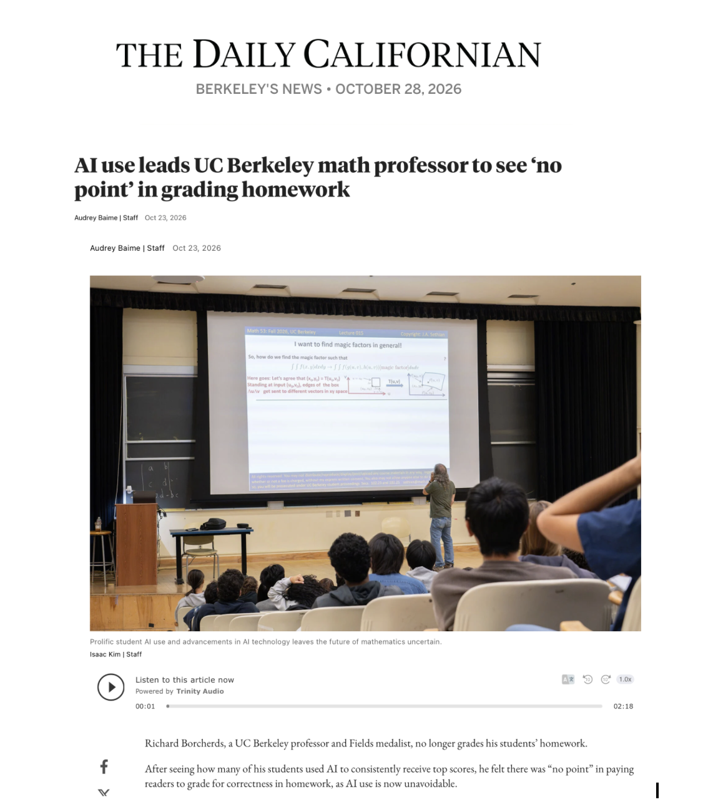
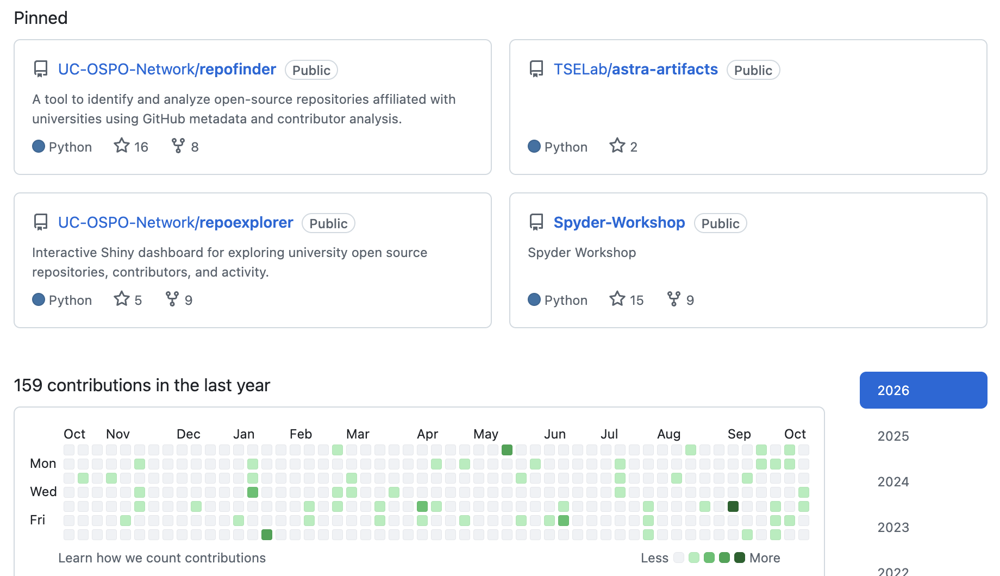

## Learning how to learn with AI, and in spite of it {.title-dark background-color="#061436"}

[A talk and discussion for Computing students]{.subtitle}

::: {.byline}
Eric Van Dusen | 25 November 2026 | Universidad Europea de Madrid

[github.com/ericvd-ucb](https://github.com/ericvd-ucb)
:::

::: {.title-logos}

{.cdss-logo}
:::

::: {.notes}
- Thank Pedro and the Computing faculty
- Plan: about 30 min talk, 30 min discussion
- In English so everyone can join; questions in Spanish welcome
:::

## Plan for today

::: {.cards}
:::: {.columns}
::: {.column}
### What is changing
How software is being built now, and where AI tools are still weak.
:::
::: {.column}
### Berkeley and California
How our courses and faculty are responding, with some examples.
:::
::: {.column}
### How to learn
What to learn with AI, and what to learn in spite of it.
:::
::::
:::

::: {.bottom-question}
The second half of the hour is for your questions and views.
:::

::: {.notes}
- Several slides draw on Pamela Fox's recent talk; credit her
- I am speaking from data science education, not from industry
:::

## What is changing {.section-dark background-color="#061436"}

## Software built by AI

- A coding agent is a language model running in a loop, with tools to read, edit and run code.
- Google reports that about 75% of its new code is AI-generated and reviewed by engineers.
- GitHub reports that over 40% of pull requests in September 2026 started from an agent's draft.
- In a survey of 900+ engineers, 55% said they regularly use agents.

[Figures as cited in P. Fox, "The Impact of AI on CS Curriculum" (2026): Fast Company, Apr 2026; GitHub Octoverse 2026; The Pragmatic Engineer survey, Mar 2026.]{.caption}

::: {.notes}
- Figures are company self-reports; treat as indicative
- Ask: how many of you already use an agent for coursework?
:::

## Where agents are still weak

::: {.cards}
:::: {.columns}
::: {.column}
### Checkable tasks
Tests pass, code compiles, output matches what was expected. Agents do this well.
:::
::: {.column}
### Judgment
Test quality, security, maintainability, whether the result does what people meant. Agents do this poorly.
:::
::::
:::

- METR (Aug 2025): 0 of 15 agent pull requests that passed tests were mergeable as-is.
- Veracode (Jul 2025): 45% of AI-generated code samples failed security tests.

[As cited in Fox (2026).]{.caption}

::: {.notes}
- This is the core of the talk: judgment is what you need to learn
- Humans are most needed at the start (what to build) and the end (does it match intent)
:::

## AI and the wider economy

- The effects of AI will extend well beyond software, across most sectors of the economy.
- It is expected to raise productivity. Those gains depend on people who can build, integrate and verify AI systems within organizations, which is the work computing graduates are trained for.
- It is also expected to reduce staffing in some roles, including some entry-level positions.

::: {.bottom-question}
How will you position yourself as this transition takes place?
:::

::: {.notes}
- Estimates of productivity gains vary widely; treat as direction, not forecast
- Entry-level hiring is where the pressure shows first
- Bridge: the second half of the talk is about how to position yourself
:::

## Email jobs {.headline background-color="#061436"}

[Will AI weaken college as the gateway to them?]{.headline-note}

Office work done mostly through email, documents and meetings. For decades, a university degree has been the usual way in.

::: {.notes}
- Informal term for white-collar office work
- Much of this work is what language models do well: drafting, summarizing, scheduling, reporting
- Open question, not a prediction; ask the room what they expect
- If degrees signal less, what signals more? Bridge to projects and GitHub later
:::

## Berkeley and California {.section-dark background-color="#061436"}

## Data science at Berkeley starts with notebooks

:::: {.columns}
::: {.column width="50%"}
- Data 8 introduces computing, statistics and inference together, in Jupyter notebooks.
- Connector courses apply the same tools in economics, demography, genetics and other fields.
:::
::: {.column width="50%"}
{.shot width="100%"}
:::
::::

::: {.big-idea}
Data science is still a great starting point for jobs in the AI era.
:::

[Connectors Library, UC Berkeley CDSS.]{.caption}

::: {.notes}
- My own path: International Development course in notebooks
- Students learn to reason with data, not only to write code
:::

## Faculty responses vary

:::: {.columns}
::: {.column width="50%"}
- Some faculty have stopped grading homework and moved weight to in-person exams.
- Others allow AI and ask students to disclose and explain their use.
:::
::: {.column width="50%"}
{.shot width="100%"}
:::
::::

[The Daily Californian, Oct 23, 2026.]{.caption}

::: {.notes}
- Borcherds example; there is no single campus policy
- Computer-Based Testing Facility as one response
:::

## How to learn {.section-dark background-color="#061436"}

## Cognitive offloading {.headline background-color="#061436"}

[Offload the routine, not the reasoning.]{.headline-note}

::: {.notes}
- Pause here; let the term land
- Ask: what did you hand to AI this week?
:::

## What we offload matters

- Cognitive offloading means using external tools to reduce mental effort. Writing, calculators and notebooks are all forms of it.
- Generative AI is different in scope: it can take over the reasoning itself, not only the routine steps.
- In one study of 666 participants, more frequent AI use was associated with weaker critical thinking, partly through greater offloading.

::: {.bottom-question}
Data science offloads computation so students can focus on reasoning. Unstructured AI use risks the reverse.
:::

[Gerlich, "AI Tools in Society: Impacts on Cognitive Offloading and the Future of Critical Thinking," *Societies* 15(1), 6 (2025). Risko and Gilbert, "Cognitive Offloading," *Trends in Cognitive Sciences* 20(9) (2016).]{.caption}

::: {.notes}
- Gerlich is correlational and self-reported; a direction, not proof
- Higher education was associated with stronger critical thinking regardless of AI use
:::

## Cognitive sovereignty {.headline background-color="#061436"}

[Governing your tools, not only operating them.]{.headline-note}

::: {.notes}
- European audience: echoes digital sovereignty debates
:::

## What cognitive sovereignty asks of students

- The risk is mistaking access to answers for ability, and ceding your own judgment to a tool that seems competent.
- The goal is to be able to question, verify and decide, including when the AI is wrong or unavailable.
- Some fundamentals still need to be learned by hand: data structures, how programs run, how to debug, how models learn from data.

::: {.bottom-question}
"You can't review what you don't understand." Jamie Maguire
:::

::: {.notes}
- Emerging term in education research and policy; used in Spanish-language circles (Tec de Monterrey observatory)
- For institutions: owning the tools, e.g. open-source Jupyter, LORCA here
:::

## Clubs {.headline background-color="#061436"}

[Learn new tools with other people.]{.headline-note}

Student clubs, hackathons and study groups are where many students first build with new tools, and where they learn to work in teams.

::: {.notes}
- Berkeley: much of the early learning about new tools happens in student-run groups
- Ask: what clubs exist here? Is there one for AI or data?
:::

## Projects {.headline background-color="#061436"}

[Build something real, for someone else.]{.headline-note}

A project shows judgment, design and verification in a way that an exam or an autograder does not.

::: {.notes}
- Personal software for family, a club, a job
- Data science version: a question, a dataset, an analysis someone will use
- UEM integrative projects as the natural home for this
:::

## GitHub {.headline background-color="#061436"}

[Keep a public record of your work.]{.headline-note}

A GitHub profile shows what you have built and how: the code, the history of changes and the documentation.

[github.com/ericvd-ucb](https://github.com/ericvd-ucb){.big-link}

::: {.notes}
- Show my profile and the universidad-europea-collab repo if time
- Employers and graduate programs look at it
- A README that explains the project is part of the work
:::

## Building a GitHub portfolio {.title-logo fig-alt="GitHub logo"}

:::: {.columns}
::: {.column width="45%"}
::: {.statement}
A portfolio documents what you built and how you thought about it.
:::

- Pinned projects, each with a short description
- A record of contributions over time
- Work in other people's projects and organizations
:::
::: {.column width="55%"}
{.shot fig-alt="Pinned repositories and contribution graph on Juanita Gómez's GitHub profile"}

[github.com/juanis2112]{.caption}
:::
::::

::: {.bottom-question}
Build a GitHub portfolio and keep improving it. A well-explained project tells an employer more than code alone.
:::

::: notes
- README with question, data, method, result
- Course projects count
:::

## Hugging Face {.headline background-color="#061436"}

[Look inside the models, not only use them.]{.headline-note}

Hugging Face hosts open models and datasets that you can download, run and study on your own computer or a university cluster.

[huggingface.co](https://huggingface.co){.big-link}

::: {.notes}
- Small models run on a laptop or in the browser: small-models-lite
- Open models are how students learn how models work, not only how to prompt them
- LORCA here at UEM could host them for courses
:::

## Small models in the browser {.lite-slide}

:::: {.columns}
::: {.column width="34%" .lite-qr}
{fig-alt="QR code linking to the Small Models in the Browser site"}

**Try it on your laptop**

[ericvd-ucb.github.io/small-models-lite](https://ericvd-ucb.github.io/small-models-lite/)
:::

::: {.column width="66%"}
{.lite-logo fig-alt="JupyterLite"}

A JupyterLite site where small language models run in the student's browser through WebLLM, with no server, API key or installation.

- Talking to models and generation settings
- Tokens, chunking and embeddings
- Memory with SQLite and embedding search
- Inside an open-weight model package

[Requires Chrome or Edge with WebGPU.]{.caption .left}
:::
::::

::: notes
- No live demo; invite students to scan and try it after the talk
- First model download takes a few minutes, then it is cached
- Thanks to Jeremy Tuloup and the JupyterLite community
- 1 min
:::

## Questions for discussion

- Should students still write code by hand, and when?
- What should be graded now?
- How do you tell whether something works?
- What happens to students who love to code?
- What would you want your professors to change?

[Several questions adapted from Fox (2026).]{.caption}

::: {.notes}
- Ask for a show of hands first: who has AI do most of their coursework?
- Leave about 30 min here
:::

## Thank you

- Eric Van Dusen, UC Berkeley CDSS
- GitHub: [ericvd-ucb](https://github.com/ericvd-ucb)

::: {.statement-2}
Further reading: Pamela Fox, "The Impact of AI on CS Curriculum" (2026), pamelafox.github.io/my-py-talks/impact-of-ai-on-cs-ed. Communications of the ACM, "Teaching Novice Computing and Programming in the Agentic AI Era." Jamie Maguire, "Syntax recall was never the goal."
:::

::: {.notes}
- Invite follow-up on the Jupyter pilot and LORCA
:::
