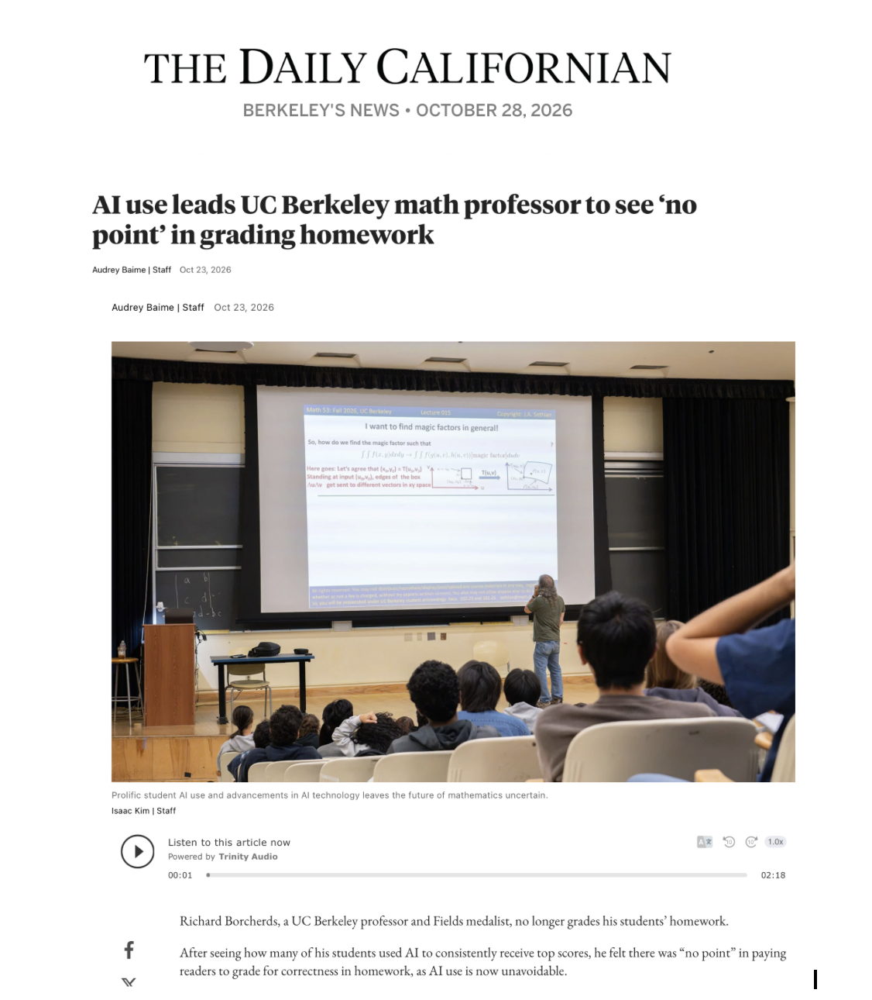
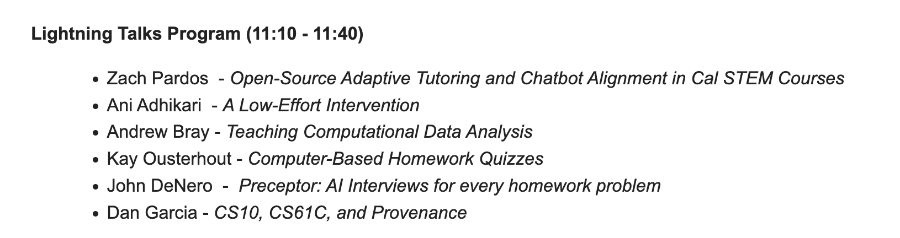
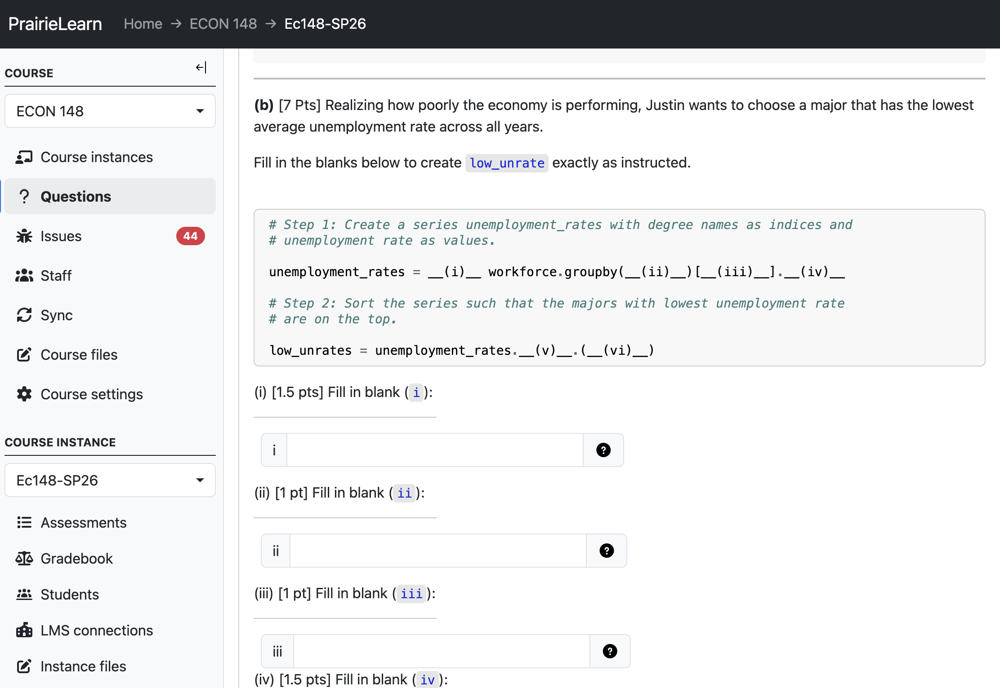
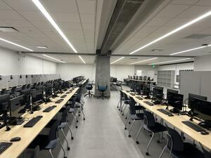
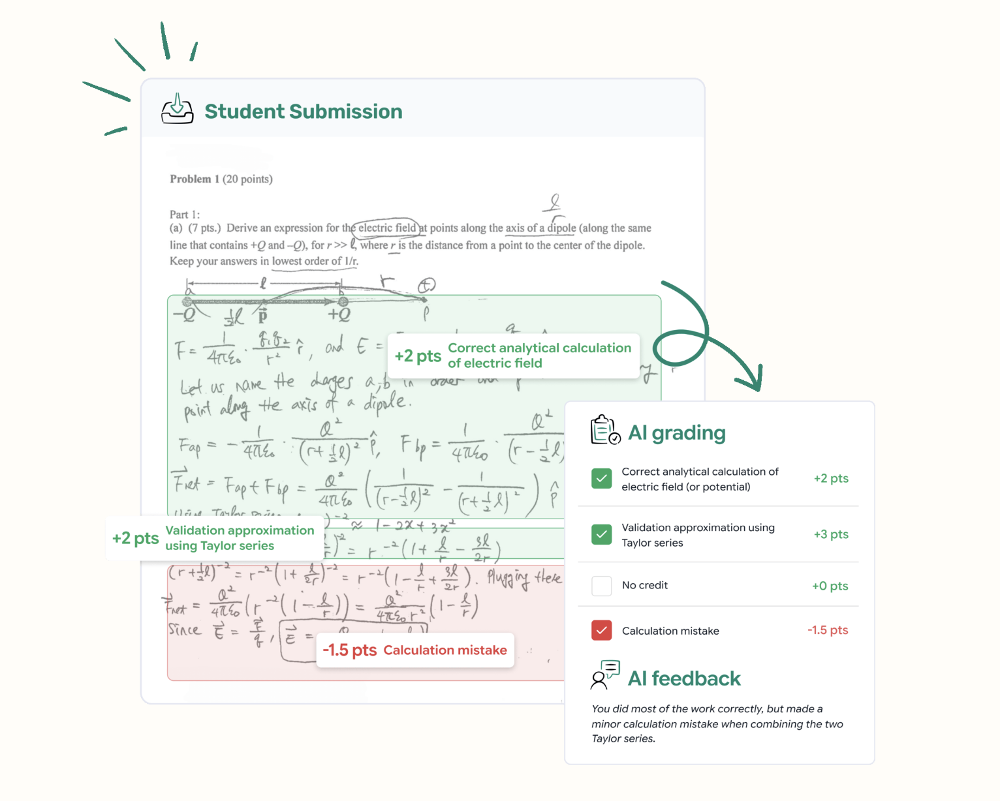
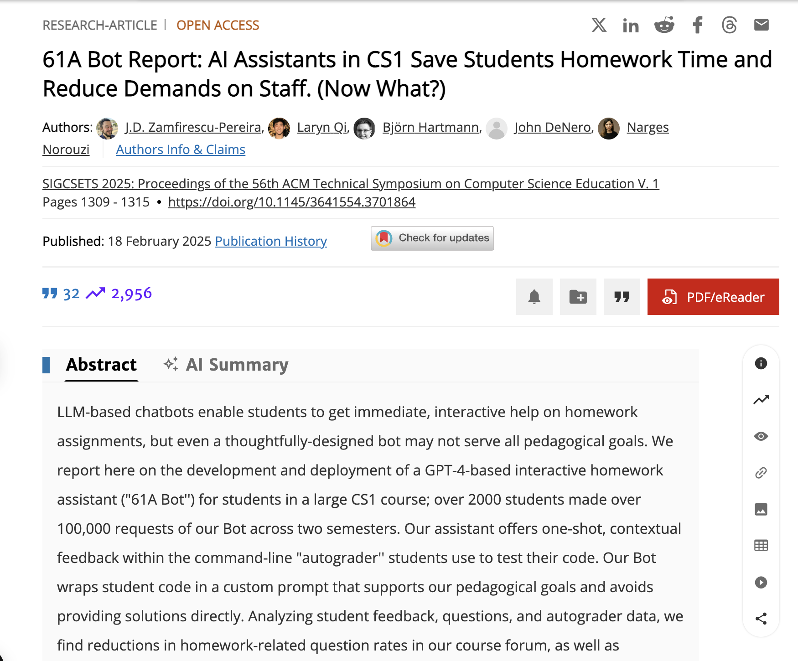
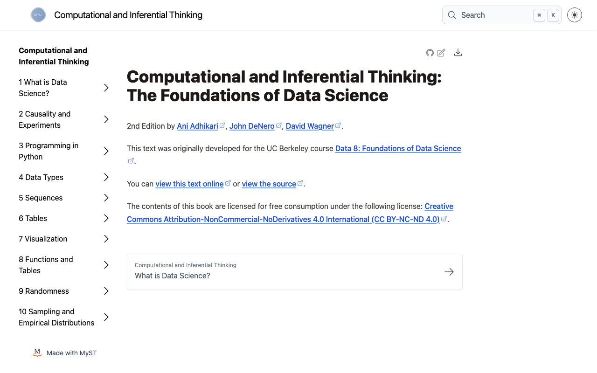
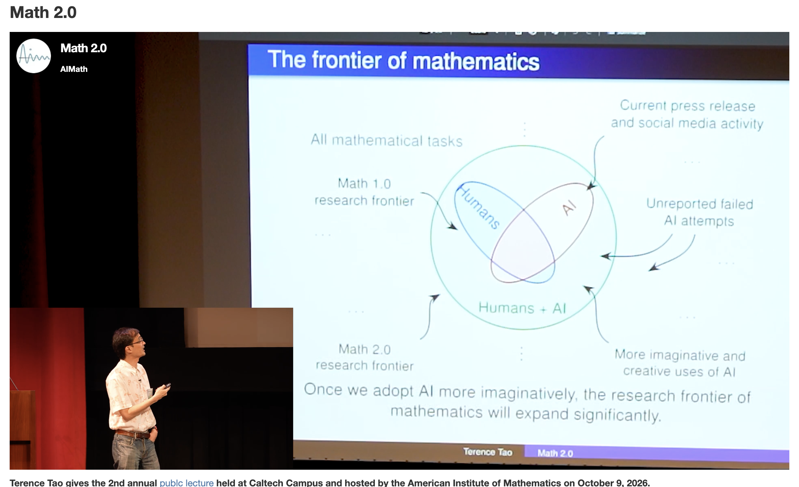

## AI and Education: Building What Learning Needs {.title-dark background-color="#061436"}

[Data science, Jupyter, and project-based STEM]{.subtitle}

::: {.byline}
**Eric Van Dusen**<br>
Universidad Europea<br>
November 4, 2026<br>
[github.com/ericvd-ucb](https://github.com/ericvd-ucb)
:::

::: {.title-logos}
{.berkeley-logo fig-alt="UC Berkeley"}
{.cdss-logo fig-alt="UC Berkeley College of Computing, Data Science, and Society"}
:::

::: notes
- Thank hosts at Universidad Europea
- 25 minutes, questions at the end
- Timing: intro 3, did AI break higher ed 7, data science 7, Jupyter and projects 6, close 2
:::

## Part 1 {.section-dark background-color="#061436"}

Did AI break higher education?

*Can we make AI better for education?*

## Did AI break higher education?

::: {.statement}
So far, in many ways, yes.
:::

- Take-home essays and problem sets no longer measure what we think they measure
- Students can produce correct answers without building the underlying skill
- Institutions have mostly responded with policy, detection and prohibition

::: {.bottom-question}
The tools students reach for were built for productivity, not for learning. I would treat this as a design problem.
:::

::: notes
- Be honest: the old assessment model is broken
- Pivot: what do we build in its place
- 2 min
:::

## Grading homework in math at Berkeley {.profile-slide}

:::: {.columns}
::: {.column width="45%"}
{.shot fig-alt="Daily Californian article: AI use leads UC Berkeley math professor to see no point in grading homework"}
:::

::: {.column width="55%"}
::: {.statement-2}
Richard Borcherds, a Fields medalist on the Berkeley mathematics faculty, no longer grades homework for correctness.
:::

- Many of his students were using AI to receive top homework scores
- He saw "no point" in paying readers to grade correctness
:::
::::

::: {.bottom-question}
If homework scores no longer show what students have learned, what should homework be for?
:::

[Audrey Baime, *The Daily Californian*, October 23, 2026]{.caption}

::: notes
- Local, recent example of the assessment problem from the previous slide
- Readers = paid undergraduate graders
- Not a criticism of Borcherds; a reasonable response to the situation
- 1 min
:::

## The evidence depends on the design

| | General chatbot | Everyday AI use | Everyday AI use | Purpose-built tutor |
|---|---|---|---|---|
| Study | Bastani et al. 2025 | Strömberg et al. 2026 | Rismanchian et al. 2026 | Kestin et al. 2025 |
| Setting | ~1,000 high school math students, Turkey | 26,811 students, grades 7 to 12, China | 3.2 million ALEKS math interactions | 194 introductory physics students, Harvard |
| Practice or homework | Large performance gains | Scores up 18%, time down 30% | Time on word problems down 27% (college) | Higher engagement, less time on task |
| Supervised exams | 17% lower once access was removed | 20% lower on closed-book exams | Proctored accuracy fell from about 80% to 60% | Roughly double the gains of an active-learning class |

::: {.bottom-question}
Where students used AI to produce answers, supervised scores fell. The tutor designed to teach is the exception.
:::

[Bastani et al., *PNAS* (2025). Strömberg, Lei and Wu, CEPR DP21577 (June 2026). Rismanchian et al., arXiv 2605.21629 (July 2026). Kestin et al., *Scientific Reports* (2025).]{.caption}

::: notes
- Bastani: a guardrailed "GPT Tutor" arm largely avoided the harm
- Strömberg: diff-in-diff, 30 months; entrance exams down 18 to 24% after about two years
- Strömberg: ~80% of AI users look like outsourcing; users who kept normal homework time had small losses
- Rismanchian: preprint, cannot observe AI use directly; gap disappears under proctoring
- Kestin: tutor designed by instructors on the same principles as their active-learning class
- 3 min
:::

## We should build the solutions, and measure them

::: {.statement}
Faculty, not vendors, know what learning looks like in our disciplines.
:::

- Design for productive struggle: AI that asks, hints and checks rather than answers
- Keep the student doing the work: code, data and reasoning stay visible
- Measure learning, not usage: pre and post assessments, autograded checks, outcomes over time
- Build in the open: share curriculum and evidence across institutions

::: notes
- We are the experts on learning; we should own the measurement
- otter-grader and autograded notebooks as existing measurement infrastructure
- 2 min
:::

## What Berkeley faculty are building now

::: {.statement-2}
Lightning talks from a Data Science Undergraduate Studies (DSUS) meeting in CDSS, where instructors shared how they are adapting courses and assessment.
:::

{.shot fig-alt="DSUS lightning talks program: Pardos, Adhikari, Bray, Ousterhout, DeNero, Garcia"}

[Data Science Undergraduate Studies, CDSS, UC Berkeley]{.caption}

::: notes
- Pardos: open-source adaptive tutoring, chatbot alignment in STEM courses
- DeNero: Preceptor, AI interviews on every homework problem
- Ousterhout: computer-based homework quizzes; Garcia: provenance in CS10 and CS61C
- Faculty building and testing, not waiting for vendors
- 1 min
:::

## How Berkeley is adapting

::: {.cards}
:::: {.columns}
::: {.column}
### Secure, frequent assessment
PrairieLearn and computer-based testing
:::
::: {.column}
### Tutors designed by instructors
Course-specific AI that gives hints, not answers
:::
::: {.column}
### AI-assisted grading
Pensieve for handwritten STEM work, with an instructor in the loop
:::
::: {.column}
### Fundamentals through doing
Data science in Jupyter notebooks
:::
::::
:::

::: {.big-idea}
Faculty design the tools, and we measure the results.
:::

::: notes
- Map for the next few slides
- A portfolio of responses, not a single product
:::

## PrairieLearn for frequent assessment

:::: {.columns}
::: {.column width="45%"}
- Open-source assessment platform from the University of Illinois
- Randomized, auto-graded questions, including code
- Supports frequent shorter exams and second-chance retakes
:::

::: {.column width="55%"}
{.shot fig-alt="PrairieLearn question from Econ 148, Spring 2026: fill in the blanks in pandas code"}
:::
::::

::: {.bottom-question}
Students still write and run code, and get feedback right away.
:::

[[prairielearn.com](https://www.prairielearn.com). Question from Econ 148, Spring 2026.]{.caption}

::: notes
- Example is from my own course, Econ 148
- Randomized variants make question sharing less useful
- 1.5 min
:::

## Computer-based testing at Berkeley

:::: {.columns}
::: {.column width="55%"}
- Proctored, scheduled exams that students take at different times
- Fall 2023: pilot with about 230 students
- August 2026: a new 100-seat facility in Moffitt Library
- Fall 2026: about 40,000 student-exam-hours scheduled across 20+ courses
:::

::: {.column width="45%"}
{.shot fig-alt="Computer-Based Testing Facility, Moffitt Library"}
:::
::::

::: {.bottom-question}
This is not a return to blue books. Proctoring protects integrity, and the exam tasks stay authentic.
:::

[Computer-Based Testing Facility, Moffitt Library, UC Berkeley]{.caption}

::: notes
- Faculty leads: Armando Fox and Dan Garcia, modeled on Illinois (Craig Zilles)
- Part of the campus Golden Bear Testing Centers initiative
- Integrity and mastery learning in the same design
- 1.5 min
:::

## Pensieve: AI-assisted grading and tutoring {.profile-slide}

:::: {.columns}
::: {.column width="55%"}
- Proposes rubric-aligned scores for handwritten STEM work
- Course staff calibrate the rubric and review uncertain cases
- Reported: about 65% less grading time
- Also a course tutor, used in Berkeley CS1 (800 students)
:::

::: {.column width="45%"}
{.shot fig-alt="Pensieve grading interface: handwritten physics solution with AI rubric scores and feedback"}
:::
::::

::: {.bottom-question}
Handwritten, open-ended work is still valuable. AI may make it affordable to keep, with faculty setting the standard.
:::

[Pensieve; results as reported by the company]{.caption}

::: notes
- Reported 95.4% agreement with instructors on high-confidence items
- Founded by a Berkeley undergraduate who saw the limits of TA support in very large courses
- Commercial platform; used at Berkeley, Columbia, Harvard and others
- An example of design principles, not an endorsement
- 1.5 min
:::

## AI tutors built by course staff

::: {.statement-2}
61A-Bot in CS 61A, Berkeley's introductory Python course, with about 1,000 students per term.
:::

- Hints delivered alongside the autograder students already use
- More than 2,000 students made over 100,000 requests across two semesters
- Homework help requests on the course forum fell sharply, and homework time dropped substantially

::: {.bottom-question}
The team asks the open question directly: saving time is not the same as learning.
:::

[Zamfirescu-Pereira et al., "61A Bot Report: AI Assistants in CS1 Save Students Homework Time and Reduce Demands on Staff. (Now What?)," SIGCSE TS 2025.]{.caption}

::: notes
- Authors include John DeNero and Narges Norouzi
- "(Now What?)": honest about what was and was not measured
- Connects back to the evidence slide: time saved vs. learning
- 1.5 min
:::

## How 61A Bot is designed {.profile-slide}

:::: {.columns}
::: {.column width="55%"}
{.shot fig-alt="ACM Digital Library page for the 61A Bot Report, SIGCSE TS 2025"}
:::

::: {.column width="45%"}
- A GPT-4 assistant inside the command-line autograder students already run
- A custom prompt wraps the student's code to support the course's goals
- One-shot, contextual feedback that avoids giving solutions directly
:::
::::

::: {.bottom-question}
The authors note that even a carefully designed bot may not serve all pedagogical goals.
:::

[Zamfirescu-Pereira, Qi, Hartmann, DeNero and Norouzi, SIGCSE TS 2025. [doi.org/10.1145/3641554.3701864](https://doi.org/10.1145/3641554.3701864)]{.caption}

::: notes
- Credit the team: J.D. Zamfirescu-Pereira, Laryn Qi, Björn Hartmann, John DeNero, Narges Norouzi
- Design choice: help lives where students already work, not in a separate chat window
- Open access paper
- 1 min
:::

## Part 2 {.section-dark background-color="#061436"}

Data science is still a good place to start

*Can we use AI to make better curriculum?*

## Data science is still a good place to start

::: {.statement}
I think AI makes the fundamentals more useful to students, not less.
:::

- Students learn to ask a question, find data, compute and argue from evidence
- Python and data are a common language for science, mathematics and economics
- Judging AI output requires these same skills: checking, testing, interpreting
- Low barrier to entry, high ceiling: first-year students and researchers use the same tools

::: notes
- Data 8 model: no prerequisites, real data from week one
- Connector courses: data science taught inside the disciplines
- 2 min
:::

## The Data 8 story {.title-logo fig-alt="Data 8 logo"}

:::: {.columns}
::: {.column width="45%"}
::: {.statement}
A first course in computing and statistics, for any major, in the browser, with real data from day one.
:::

::: {.statement-2}
The largest course at UC Berkeley. Up to half of undergraduates take it, and it is the gateway to Berkeley's largest major.
:::
:::

::: {.column width="55%"}
{.shot fig-alt="Computational and Inferential Thinking, the open Data 8 textbook"}

[inferentialthinking.com]{.caption}
:::
::::

::: {.bottom-question}
Students did not have to learn all of the machinery before they could do data science.
:::

::: notes
- About me: Tech and Outreach Lead, CDSS; lecturer
- Data 8, Data 88E, DataHub: open curriculum, cloud notebooks
- 1.5 min
:::

## Data Science Modules across campus

::: {.statement-2}
Short Jupyter notebooks that let students work hands-on with a dataset from their own course, as a lab, homework or project.
:::

::: {.cards .stats}
:::: {.columns}
::: {.column}
### 13,000+
students
:::
::: {.column}
### 80+
courses
:::
::: {.column}
### 40+
departments
:::
::: {.column}
### 250+
notebooks
:::
::::
:::

::: {.chips .three}
- Economics
- Public Health
- English
- Biology
- Physics
- Earth Science
:::

::: {.bottom-question}
Examples include Biology 1B (700 students), MCB 32L Human Physiology, and American Cultures courses in Sociology, Psychology and Ethnic Studies.
:::

[Figures as of 2022. [ds-modules.github.io/modules-textbook](https://ds-modules.github.io/modules-textbook/)]{.caption}

::: notes
- Built by a student developer team working with faculty
- Bio 1B: Strawberry Creek bioindicators, Prof. George Roderick; diversity measures, hypothesis testing
- MCB 32L: Robin Ball; replaced a photocopied reader and Excel lab notebook
- American Cultures: 200 to 300 students, many who would not choose computing
- Numbers have grown since 2022
- 1.5 min
:::

## Terence Tao: the frontier keeps expanding

:::: {.columns}
::: {.column width="46%"}
{.shot fig-alt="Terence Tao, Math 2.0, Caltech, October 2026"}

[Terence Tao, "[Math 2.0](https://teorth.github.io/tao-web/slides/math-2-0-caltech-2026.pdf)," AIM Public Lecture, Caltech, October 2026. [Video](https://aimath.org/videos/terry-tao-pl/)]{.caption}
:::

::: {.column width="54%"}
::: {.statement-2}
"We are now entering an era of proof abundance in mathematics."

"The future frontiers of mathematics will always continue to expand."
:::

The same holds for data science:

- Instructors can build richer labs and explorations
- Students can take on more ambitious projects
- More questions become feasible, in more fields
:::
::::

::: {.big-idea}
AI does not leave less data science to do. It leaves more.
:::

::: notes
- Math 1.0 assumed proofs were scarce; AI makes them abundant, frontier moves outward
- Tao keeps human understanding at the center
- Faculty as curriculum builders, AI as assistant
- 2.5 min
:::

## A notebook is a project

Jupyter notebooks already combine the elements of project-based learning.

:::: {.columns}
::: {.column width="50%"}
- Data: a real question and a real dataset
- Code: the student does the analysis
- Narrative: reasoning written alongside results
- Checks: autograded feedback along the way
:::
::: {.column width="50%"}
- Fits integrative projects across a degree
- Supports teamwork and versioned collaboration
- Produces a shareable, reproducible artifact
- Gives instructors evidence of the process, not only the product
:::
::::

::: notes
- Connect to Europea's integrative projects (proyectos integradores) and the PBS model
- Process evidence matters more now
- 2 min
:::

## What Jupyter offers project-based STEM

- Zero install: JupyterHub and JupyterLite run in the browser
- Open curriculum: Data 8 and related materials are freely available to adapt
- Assessment built in: otter-grader for autograded checks inside notebooks
- AI in the right place: assistants inside the notebook, configured by the instructor
- Infrastructure at scale: Berkeley DataHub and Cloudbank serve thousands of students

::: notes
- 2i2c and community partners if asked about hosting
- Practical: what a Europea instructor could try next term
- 2 min
:::

## Small open models as teaching tools

:::: {.columns}
::: {.column width="42%"}
Small open weight models are accessible, inspectable, and testable resources that eg free to download and play with. Understanding LLMs does not need a frontier model.

- Use notebook as a sandbox for students to explore how LLMs work
- Tokens and next-token probabilities
- Harness - data in and out, reasoning, agents
- The linear algebra underneath
:::

::: {.column width="58%"}
```{.python code-line-numbers="false"}
from transformers import AutoTokenizer
from transformers import AutoModelForCausalLM

name = "HuggingFaceTB/SmolLM2-135M"  # 270 MB
tok = AutoTokenizer.from_pretrained(name)
lm = AutoModelForCausalLM.from_pretrained(name)

prompt = "Madrid is famous for its"
ids = tok(prompt, return_tensors="pt")
probs = lm(**ids).logits[0, -1].softmax(-1)
for p, i in zip(*probs.topk(5)):
    print(tok.decode(i), f"{p:.0%}")
```

{.center-logo fig-alt="Hugging Face, Ollama, and Jupyter logos combined"}
:::
::::

::: notes
- Demystification as part of AI literacy
- One to seven billion parameters is enough for most teaching purposes
- 1.5 min
:::

## Why small open models?

::: {.cards}
:::: {.columns}
::: {.column}
### Environment and carbon
Data centres used about 485 TWh last year, roughly as much as Germany, and the IEA expects that to double by 2030. Laptops and campus servers use little power and need little cooling.
:::
::: {.column}
### Sovereignty
Models on institutional servers keep control of the tools, the data and privacy. Open-weight models trail the frontier by about four months.
:::
::: {.column}
### Less corporate control over education
Courses built on open models do not depend on a company's pricing, terms of service or product decisions. Subsidized AI for rent cannot last indefinitely.
:::
::::
:::

::: {.bottom-question}
"Educators can train students not only how to use AI models, but also how to determine when local models are preferable to cloud-based systems."
:::

[Buhler, Pérez & Boettiger, "[Scientists should shift away from AI data centres](https://www.nature.com/articles/d41586-026-02451-2)," *Nature* 656, 296–298 (2026)]{.caption}

::: notes
- Nature Comment by Cassidy Buhler, Fernando Pérez and Carl Boettiger (Schmidt Center for Data Science & Environment, Berkeley)
- Corporate openness can change with the next release; curriculum should be able to swap models
- 2 min
:::

## Small models in the browser {.lite-slide}

:::: {.columns}
::: {.column width="34%" .lite-qr}
{fig-alt="QR code linking to the Small Models in the Browser site"}

**Try it on your laptop**

[ericvd-ucb.github.io/small-models-lite](https://ericvd-ucb.github.io/small-models-lite/)
:::

::: {.column width="66%"}
{.lite-logo fig-alt="JupyterLite"}

A JupyterLite site where small language models run in the student's browser through WebLLM, with no server, API key or installation.

- Talking to models and generation settings
- Tokens, chunking and embeddings
- Memory with SQLite and embedding search
- Inside an open-weight model package

[Requires Chrome or Edge with WebGPU.]{.caption .left}
:::
::::

::: notes
- No live demo; invite students to scan and try it after the talk
- First model download takes a few minutes, then it is cached
- Thanks to Jeremy Tuloup and the JupyterLite community
- 1 min
:::

## "Cognitive offloading"

::: {.statement-2}
Using external tools to reduce mental effort. Mental effort is how we learn, form neural connections, and build judgment. The term predates AI, but it is visible in our students' use of AI.
:::

- Generative AI is different in scope: it can take over the reasoning, not only the routine steps
- Gerlich (2025), 666 participants: more frequent AI use correlated with weaker critical thinking, partly through greater offloading
- Higher educational attainment was associated with stronger critical thinking, regardless of AI use

::: {.bottom-question}
The question is what we offload. Data science offloads computation so students can focus on reasoning. Unstructured AI use risks the reverse.
:::

[Gerlich, "AI Tools in Society: Impacts on Cognitive Offloading and the Future of Critical Thinking," *Societies* 15(1), 6 (2025). Risko and Gilbert, "Cognitive Offloading," *Trends in Cognitive Sciences* 20(9) (2016).]{.caption}

::: notes
- Term from cognitive psychology (Risko and Gilbert, 2016), predates AI
- Gerlich is correlational and self-reported; use as direction, not proof
- Education as a protective factor: a role for universities
- Link back to Bastani: students offloaded the reasoning
- Offload the routine, not the reasoning
- 2 min
:::

## "Cognitive sovereignty"

::: {.statement-2}
The capacity to govern our cognitive tools, not only operate them. An emerging term in education research and policy discussion.
:::

- The risk: learners cede their own judgment and mistake access to answers for ability
- The goal: students who can question, verify, and decide when the AI is wrong or unavailable
- Can we tell if a thought is genuinely our own?

::: {.cards}
:::: {.columns}
::: {.column}
### For students
Sustained judgment, built through effortful practice and secure assessment
:::
::: {.column}
### For institutions
Ownership of tools and curriculum, through open-source infrastructure such as Jupyter and PrairieLearn, designed and evaluated by faculty
:::
::::
:::

::: notes
- Frontiers in AI (2025) framing: tools should demand engagement, not supply answers
- Used in Spanish-language education circles (Tec de Monterrey observatory)
- For a European audience: echoes digital sovereignty debates
- Leads into the invitation: build this together
- 2 min
:::

## An invitation

- Work together to build cool notebooks and projects for UE
- Share curriculum in both directions, in English and Spanish
- Small open weight models for teaching and learning
- Open Source education - how to work across departments and campuses

::: notes
- This is the ask; keep it concrete and modest
- Offer to send materials and set up a follow-up call
- 1.5 min
:::

## Thank you {.center}

::: {.statement}
Eric Van Dusen<br>
College of Computing, Data Science, and Society, UC Berkeley
:::

[ericvd@berkeley.edu · [github.com/ericvd-ucb](https://github.com/ericvd-ucb)]{.caption}

::: notes
- Ask: which projects would benefit most from notebooks?
:::
