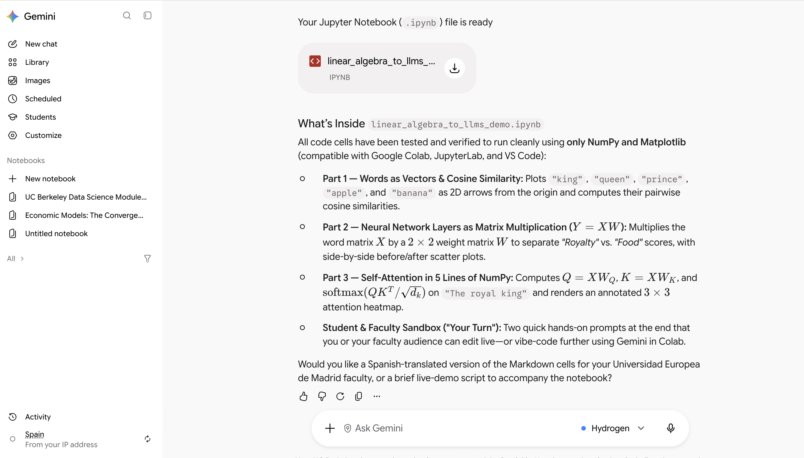
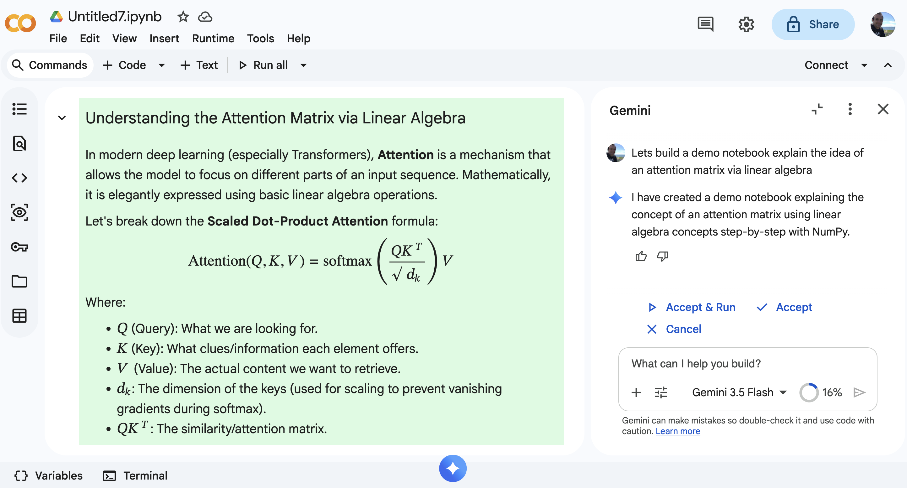

## Jupyter in Teaching: Building with AI {.title-dark background-color="#061436"}

[A workshop for faculty, Universidad Europea de Madrid]{.subtitle}

::: {.byline}
**Eric Van Dusen**<br>
26 November 2026<br>
[github.com/ericvd-ucb](https://github.com/ericvd-ucb)
:::

::: {.title-logos}
{.berkeley-logo fig-alt="UC Berkeley"}

{.cdss-logo fig-alt="UC Berkeley College of Computing, Data Science, and Society"}

{.jupyter-logo fig-alt="Project Jupyter"}
:::

## Where we left off

- **4 November:** AI and Education. AI has disrupted higher education faster than institutions have adapted, but faculty can design, build and measure better learning experiences.
- **19 November:** Jupyter Notebooks. How UEM faculty already teach with notebooks: open data, reproducible articles, satellite data, protein folding.
- **Today:** how to *make* a teaching notebook with AI as a collaborator, using Gemini, Colab and VS Code.

::: {.notes}
Thank the pilot faculty by name if present (Gabriel, Marcos, Javier, Maria, Jose Manel).
:::

## Part 1: AI and the faculty role {.section-dark background-color="#061436"}

## The question has changed

- AI can now write a working notebook from a one-sentence request.
- The scarce skill is no longer typing code. It is **knowing what to ask for, judging what comes back, and designing for learning.**
- Those are exactly the skills faculty already have in their own discipline.

::: {.bottom-question}
The goal of this workshop: faculty as *authors and editors* of AI-assisted learning materials, not only as consumers of AI tools.
:::

## Three roles for AI in a course

| Role | Who uses it | Example |
|---|---|---|
| AI as **tutor** | Students | A Gem or NotebookLM grounded in course materials that guides rather than answers |
| AI as **co-author** | Faculty | Building a notebook, an exercise set or a dataset walkthrough with an assistant |
| AI as **subject** | Students and faculty | Teaching how models work, where they fail, and how to verify their output |

::: {.notes}
Today focuses on the first two. The third is the Small Models curriculum, mention only if asked.
:::

## Working principles

1. **Keep the learning with the student.** Tools should prompt thinking, not replace it.
2. **Verify everything.** Run the code, check the numbers, read the diff.
3. **Ground in your materials.** Prefer AI that works from your notes, data and readings.
4. **Be transparent.** Tell students which tools are allowed, for what, and why.
5. **Measure.** Treat each AI intervention as a small experiment in your course.

## Part 2: Anatomy of a successful teaching notebook {.section-dark background-color="#061436"}

## Five elements

1. **Context.** Course, topic, motivation and two to four learning objectives.
2. **Data.** A real dataset, loaded from a stable source, with units and provenance explained.
3. **Guided exploration.** Short Markdown explanations alternating with short code cells, each producing a visible result.
4. **Student tasks.** Clearly marked "Your turn" cells with a scaffold, not a solution.
5. **Reflection.** One or two questions that return to the discipline, not to the code.

::: {.notes}
These five elements go into the prompts and the instructions file in the demos.
:::

## Finding source material

- **Course notebooks on GitHub.** Search GitHub for your topic plus "ipynb" or "jupyter book".
- **Open textbooks built from notebooks:** [Data 8, *Computational and Inferential Thinking*](https://inferentialthinking.com) and [Data 88E, Economic Models](https://data88e.org/textbook/).
- **Open data:** [datos.gob.es](https://datos.gob.es), [INE](https://www.ine.es), [Eurostat](https://ec.europa.eu/eurostat/data/database), [Our World in Data](https://ourworldindata.org).
- **Your own research data**, reduced to a teaching-sized subset.

::: {.bottom-question}
A useful prompt pattern: *"Here is a notebook from another course. Adapt it for my second-year students in [discipline], using this dataset."*
:::

## Part 3: Building notebooks with Gemini {.section-dark background-color="#061436"}

## What UEM faculty can use

- **Gemini app** at [gemini.google.com](https://gemini.google.com): conversation, Guided Learning, and Gems (custom assistants with your instructions and files).
- **[Google Colab](https://colab.research.google.com):** hosted Jupyter notebooks with Gemini built in, including a side panel, a data science agent, **Learn Mode** and notebook-level **Custom Instructions**.
- **VS Code** with the Jupyter extension and an AI coding assistant: the full authoring environment, on your own computer.

::: {.notes}
Confirm beforehand which Google account type faculty use for Gemini and Colab.
:::

## Three ways to build a notebook, with increasing control

| | Demo 1: Gemini chat | Demo 2: Colab and Gemini | Demo 3: VS Code |
|---|---|---|---|
| Where you work | A conversation | Notebook on the left, Gemini on the right | Files, notebook and agent side by side |
| Where the code runs | Elsewhere, after export | Google's servers | Your computer or a JupyterHub |
| What you control | The request | Each cell, with AI suggestions | Every file, version and dependency |
| Best for | A first draft in minutes | Building and testing with students' tools | Course materials you maintain over years |

## Demo 1: From a conversation to a notebook {.section-dark background-color="#061436"}

## Demo 1: describe the notebook you want

::: {.prompt}
I teach [course] to [level] students at Universidad Europea. Plan a Jupyter notebook on [topic] for one class session. Use the CO2 data from Our World in Data: https://raw.githubusercontent.com/owid/co2-data/master/owid-co2-data.csv. Include learning objectives, short explanations, code cells that each show one result, two "Your turn" exercises and a reflection question. Show me the plan first.
:::

- Review the plan as you would a teaching assistant's draft, and ask for changes.
- Then: *"Now write the complete notebook as a downloadable .ipynb file."*

::: {.notes}
Live in gemini.google.com. Push back on one element of the plan to show iteration.
:::

## Demo 1: the conversation in Gemini

{.shot fig-align="center" height="520" fig-alt="Gemini app with a finished .ipynb file ready to download"}

::: {.notes}
- The .ipynb arrives as a file with a download button
- Gemini summarises what is inside; check that against the notebook
:::

## Demo 1: download, upload, share

1. **Get the file.** Download the `.ipynb`, or with a personal Google account use **Share & export > Export to Colab**.
2. **Upload it** where students work: Colab (**File > Upload notebook**), the virtual campus, or a JupyterHub.
3. **Run every cell** before sharing. Fix what fails, and check every number and chart.
4. **Share it:** a Colab link set to *viewer*, so each student saves their own copy; or a file in the course page.

::: {.bottom-question}
Export to Colab is not currently available for Workspace (institutional) accounts, which is why the download and upload route matters.
:::

## Demo 2: Colab with Gemini alongside {.section-dark background-color="#061436"}

## Demo 2: Colab with the Gemini panel

{.shot fig-align="center" height="520" fig-alt="Colab notebook on the left with the Gemini side panel on the right"}

::: {.notes}
- Notebook on the left, Gemini panel on the right
- Point out Accept & Run, Accept, Cancel: nothing changes without approval
:::

## Demo 2: the notebook on the left, Gemini on the right

1. Upload the notebook from Demo 1 to [Colab](https://colab.research.google.com).
2. Open the **Gemini side panel**. Gemini reads the whole notebook as context.
3. Ask, one step at a time:

::: {.prompt}
Explain what this notebook does, cell by cell, for a first-year student.
:::
::: {.prompt}
Add Portugal and France to the chart in cell 5 and fix the axis labels.
:::
::: {.prompt}
Este código da un error. Explica la causa y propón una corrección.
:::

::: {.notes}
Show accepting and rejecting a suggested change. Run cells between prompts.
:::

## Demo 2: making Colab a tutor for your students

- **Learn Mode** turns Gemini into a coding tutor that gives step-by-step guidance instead of writing the code.
- **Custom Instructions** are saved inside the notebook, so every student who opens it gets the assistant you configured.

::: {.prompt}
You are helping students in [course]. Use pandas and matplotlib only. Do not write complete solutions to the "Your turn" exercises; give hints and ask the student to explain their reasoning. Answer in the student's language.
:::

::: {.bottom-question}
The notebook now carries both the lesson and the rules for its AI assistant.
:::

## Demo 3: A vibecoding setup in VS Code {.section-dark background-color="#061436"}

## Demo 3: the setup

- **[VS Code](https://code.visualstudio.com)** with the **[Jupyter extension](https://marketplace.visualstudio.com/items?itemName=ms-toolsai.jupyter)** and a Python environment.
- **An AI coding agent** in the side panel. I use Claude Code; GitHub Copilot and Gemini Code Assist work in a similar way.
- **A course folder under version control** with GitHub Desktop, so every AI change can be reviewed and undone.
- **An instructions file** in the folder that tells the agent how notebooks for this course are built: structure, libraries, language, what never to do.

::: {.notes}
Show the folder, the instructions file and a commit history with AI changes.
:::

## Demo 3: the workflow

1. **Plan:** ask the agent to propose the notebook outline; edit it.
2. **Generate:** the agent writes cells and data loading code into the `.ipynb`.
3. **Run:** execute in VS Code; the agent reads the errors and fixes them.
4. **Review:** read the diff of every change before accepting it.
5. **Commit:** save a version in GitHub Desktop with a short message.
6. **Publish:** push to GitHub, where students open it in Colab or a JupyterHub.

::: {.bottom-question}
The same notebook moves between all three settings: drafted in Gemini, tested in Colab, maintained in VS Code.
:::

## Beyond building: course tutor Gems

- A **Gem** with your instructions and course files can act as a tutor that guides rather than answers.
- Test it before sharing: ask for the answer to an exercise, give it a false premise, try it in Spanish and English.

::: {.bottom-question}
With Cristina Guerrero we are developing an automated tester that runs questions like these against every faculty Gem: does it give away answers, and does it stay within the course materials?
:::

::: {.notes}
Optional; skip if short on time.
:::

## Part 4: Design issues {.section-dark background-color="#061436"}

## Packages: fewer is better

- **Import every package in the first code cell**, so readers see the dependencies at once.
- **Packages depend on other packages**, and each one is another way for a student's setup to fail.
- **Versions can matter.** Record them for materials you will reuse.
- **There may already be a package for what you are doing.** Weigh it against one more dependency.

::: {.nb-cell n="1"}
```python
# Setup: all imports in one place
import pandas as pd
import matplotlib.pyplot as plt
```
:::

::: {.notes}
Ask the AI which packages it used and whether any can be removed.
:::

## Keeping the code simple enough to teach

- AI tends to write code for professionals: long chains of methods, defensive checks, helper functions. In my experience this is the hardest thing to steer.
- **Wrapper functions are a design decision.** Hide complexity that is not the lesson; show the code that is.
- **Simple graphs versus fancy graphs.** A clear line chart with labelled axes usually teaches more than an interactive display.

::: {.prompt}
Write this for students who have used Python for three weeks. One idea per cell. No functions unless I ask. Use pandas and matplotlib only, with a simple chart.
:::

::: {.notes}
Show a before and after of the same cell.
:::

## Explanations in Markdown: where your expertise matters

- **You know far more about your discipline than the AI.** The Markdown cells are where that knowledge reaches students.
- **Steer it.** Let the AI draft, then rewrite in your own voice: add context, examples and the misconceptions you see in class.
- **Move the learning into the notebook.** Part of the vision is that the explanation now on your slides lives beside the computation.
- **Worth iterating on.** This is the part students read most closely.

## LaTeX in Markdown cells

:::: {.columns}
::: {.column width="50%"}
While editing:

::: {.nb-md-edit}
```markdown
The annual growth rate of emissions:
$$ g_t = \frac{E_t - E_{t-1}}{E_{t-1}} $$
```
:::
:::
::: {.column width="50%"}
After running the cell:

::: {.nb-md}
The annual growth rate of emissions:
$$ g_t = \frac{E_t - E_{t-1}}{E_{t-1}} $$
:::
:::
::::

## Where is the data?

| Source | Strength | Watch for |
|---|---|---|
| **API or URL** | Current data, nothing to distribute | Network access, changes by the provider |
| **CSV file** | Stable and simple | Where the file lives when the notebook moves |
| **CSV hosted on GitHub** | One URL that works in Colab, JupyterHub and on laptops | Size limits; keep a teaching-sized subset |

::: {.nb-cell n="2"}
```python
url = ("https://raw.githubusercontent.com/owid/"
       "co2-data/master/owid-co2-data.csv")
co2 = pd.read_csv(url)
co2[co2["country"] == "Spain"][["year", "co2", "co2_per_capita"]].tail(3)
```
::: {.nb-out n="2"}
```
       year      co2  co2_per_capita
48295  2023  211.737           4.419
48296  2024  208.652           4.355
48297  2025  210.493           4.395
```
:::
:::

::: {.notes}
Always state the source, licence and units in Markdown next to the loading cell.
:::

## Not every notebook needs data

- **Mathematics:** derivations, numerical methods and visualising functions; the notebook as a calculator with a memory.
- **Simulation:** random processes, Monte Carlo methods, models that students change and rerun.
- **Devices and sensors:** reading instruments and live measurements directly into the notebook.
- **The lab notebook:** in biology or benchtop work, protocol, observations and analysis recorded together.

::: {.bottom-question}
The same design questions apply: few packages, simple code, explanations in your own words.
:::

::: {.notes}
Point to pilot examples from UEM faculty where they fit.
:::

## A caution on "bring your own dataset"

Open-ended projects with student-chosen data often go wrong:

- Students are not yet reliable judges of data quality
- Data may be censored, suppressed or incomplete
- The question may not match what the data can show
- Weeks are lost to searching and cleaning
- AI will analyse a poor dataset without objection

::: {.notes}
- Example: a team finds in week 6 that the variable they need does not exist
- Censoring: survivorship, suppressed small counts, top-coding
- AI can invent datasets
:::

## Structured openness

1. **Curated menu:** 5 to 10 vetted datasets, open choice of question
2. **Data audit milestone:** source, method, gaps, limits
3. **Question and data fit check:** approved before analysis begins

::: {.bottom-question}
Freedom in the question, structure in the data.
:::

::: {.notes}
- The audit can be AI-assisted; prompt is in the handout
- Gabriel's open data courses as a model
:::

## Part 5: Sharing and deploying {.section-dark background-color="#061436"}

## From your laptop to your students

| Route | Best for | Students need |
|---|---|---|
| Download `.ipynb` and upload to the virtual campus | One-off exercises | A notebook environment |
| Colab link (viewer access, students save a copy) | Courses already using Google | A Google account |
| GitHub repository with an **Open in Colab** link | Materials reused across terms | A Google account |
| **JupyterHub** on LORCA (proposed) | Large data, GPUs, whole courses | A university login |

::: {.notes}
LORCA JupyterHub memo in progress.
:::

## Discussion {.section-dark background-color="#061436"}

## Questions for the room

- Which of today's tools would you use **next term**, and for what?
- Where should students be **required to work without AI**?
- How would you **know** whether a Gem or an AI-assisted notebook improved learning in your course?
- What support would make this sustainable at UEM: shared Gems, a notebook library, a JupyterHub?

## Resources

:::: {.columns}
::: {.column width="50%"}
**Google tools**

- [Gemini](https://gemini.google.com) and [Gemini for Education](https://edu.google.com/ai/gemini-for-education/)
- [Exporting from Gemini](https://support.google.com/gemini/answer/14184041)
- [Google Colab](https://colab.research.google.com)
- [Colab Learn Mode and Custom Instructions](https://blog.google/innovation-and-ai/technology/developers-tools/colab-updates/)
- [Guided Learning](https://blog.google/outreach-initiatives/education/guided-learning/)
:::
::: {.column width="50%"}
**Authoring tools**

- [VS Code](https://code.visualstudio.com) and its [Jupyter extension](https://marketplace.visualstudio.com/items?itemName=ms-toolsai.jupyter)
- [GitHub Desktop](https://desktop.github.com)

**Data and examples**

- [Our World in Data, CO2 dataset](https://github.com/owid/co2-data)
- [Data 8 textbook](https://inferentialthinking.com)
- [Data 88E textbook](https://data88e.org/textbook/)
:::
::::

## Small models in the browser {.lite-slide}

:::: {.columns}
::: {.column width="34%" .lite-qr}
{fig-alt="QR code linking to the Small Models in the Browser site"}

**Try it on your laptop**

[ericvd-ucb.github.io/small-models-lite](https://ericvd-ucb.github.io/small-models-lite/)
:::

::: {.column width="66%"}
{.lite-logo fig-alt="JupyterLite"}

A JupyterLite site where small language models run in the student's browser through WebLLM, with no server, API key or installation.

- Talking to models and generation settings
- Tokens, chunking and embeddings
- Memory with SQLite and embedding search
- Inside an open-weight model package

[Requires Chrome or Edge with WebGPU.]{.caption .left}
:::
::::

::: notes
- No live demo; invite faculty to scan and try it after the talk
- First model download takes a few minutes, then it is cached
- Thanks to Jeremy Tuloup and the JupyterLite community
- 1 min
:::

## Thank you {.section-dark background-color="#061436"}

**Eric Van Dusen**

College of Computing, Data Science, and Society, UC Berkeley

GitHub: [ericvd-ucb](https://github.com/ericvd-ucb)

::: {.notes}
Offer to share the deck and the demo notebook.
:::
