## Jupyter Notebooks in the Classroom {.title-dark background-color="#061436"}

[Meeting students and faculty where they are]{.subtitle}

::: {.byline}
**Eric Van Dusen** 
Universidad Europea de Madrid 
19 November 2026 
[github.com/ericvd-ucb](https://github.com/ericvd-ucb)
:::

::: {.title-logos}
{.berkeley-logo fig-alt="UC Berkeley"}
{.cdss-logo fig-alt="UC Berkeley College of Computing, Data Science, and Society"}
{.jupyter-logo fig-alt="Project Jupyter"}
:::

::: notes
- Thank UEM hosts by name
- 40 min talk, then 40 min hands-on in Colab
- Ask who has used a notebook before (show of hands)
:::

## Plan for today

::: {.cards}
:::: {.columns}
::: {.column}
### Talk, 40 minutes

- My path into notebooks
- How notebooks grew at Berkeley
- Design principles for faculty
- Jupyter at UEM today
- From notebook to LORCA
:::
::: {.column}
### Hands-on, 40 minutes

- Open a notebook in Google Colab
- Reproduce a published chart on the Spanish economy
- Change the indicator or time period
- Discuss how to adapt it for your course
:::
::::
:::

::: notes
- Laptops needed for the second half
- A Google account is enough; nothing to install
:::

## Disambiguation: what is Jupyter?

::: {.cards}
:::: {.columns}
::: {.column}
### 1. A file type

A notebook is an `.ipynb` file, stored as JSON.

One file holds Markdown text, code and the computational outputs.
:::
::: {.column}
### 2. A way to scaffold compute

The notebook plus its packages and environment files.

Together they make sure the compute works anywhere.
:::
::: {.column}
### 3. A software IDE

JupyterLab and Jupyter Notebook open and run notebook files.

You can also work in Google Colab, VS Code and others.
:::
::::
:::

::: notes
- When people say "Jupyter" they can mean any of these three
- Today we use the file type in Colab, not the Jupyter software itself
:::

## My path into notebooks {.profile-slide}

:::: {.columns}
::: {.column width="45%"}
- My background is in international development
- A new role at Berkeley let me teach a new International Development course
- The course was built on notebooks from the start
- LS 88: Behind the Curtain in International Development
:::

::: {.column width="55%"}
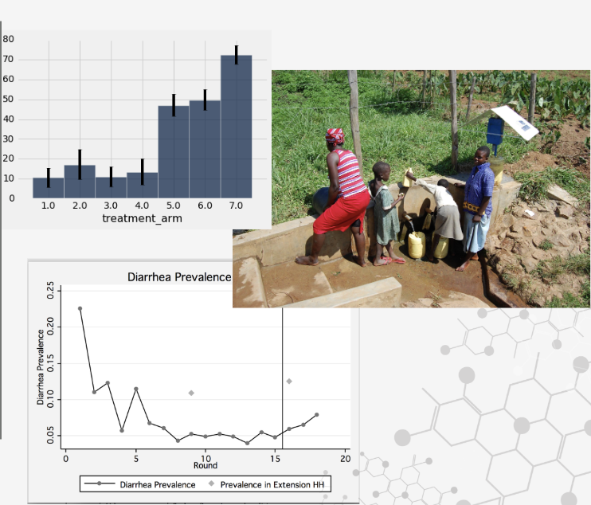{.shot fig-alt="Charts from development field data, outcomes by treatment arm and diarrhea prevalence by survey round, with a photo of a community water source"}
:::
::::

::: notes
- Came to teaching from development work, not from computer science
- Name the role and year
- 2 to 3 min
:::

## A development course in notebooks

:::: {.columns}
::: {.column width="50%"}
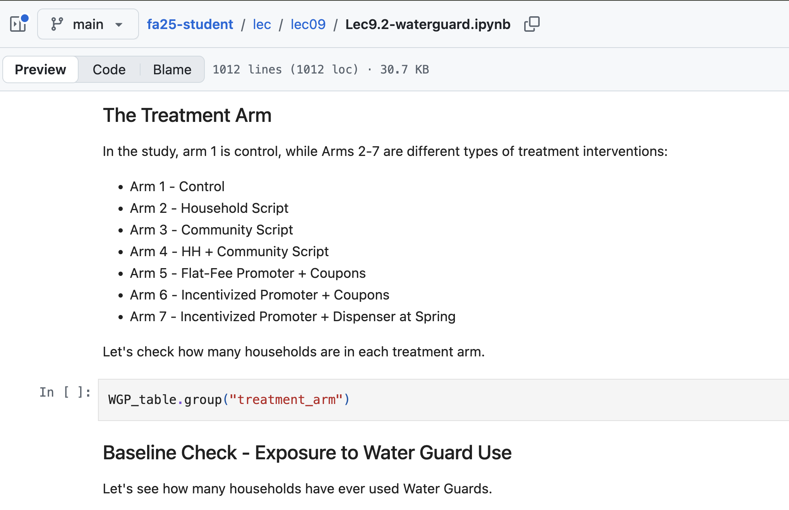{.shot fig-alt="Course notebook Lec9.2-waterguard.ipynb listing seven treatment arms, from control to an incentivized promoter with a dispenser at the spring, and a code cell grouping households by treatment arm"}
:::

::: {.column width="50%"}
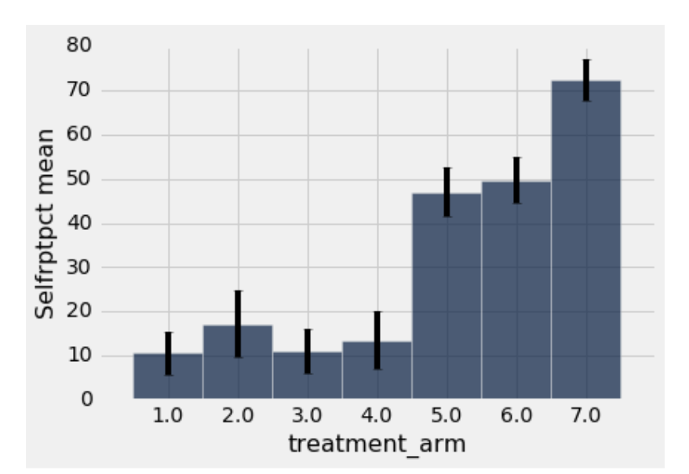{.shot fig-alt="Bar chart of mean self-reported WaterGuard use by treatment arm, with error bars; arms 5 to 7 are much higher than arms 1 to 4"}
:::
::::

[Lecture 9.2, WaterGuard study notebook, fa25-student repository]{.caption}

::: {.bottom-question}
The course began from questions in development economics. The notebook was the tool for working on them.
:::

::: notes
- Key point: the discipline came first, the notebook served it
- Walk through the WaterGuard notebook: seven treatment arms, households grouped by arm
- Chart: self-reported use is much higher in arms 5 to 7 (promoters, coupons, dispenser)
- Credit the study authors
- 2 min
:::

## What that first course taught me

::: {.cards}
:::: {.columns}
::: {.column}
### Real data

Students worked directly with development data from the first week.

Data from the WaterGuard household water treatment study.

This data was also in published journal articles.
:::
::: {.column}
### What worked

Taking students from messy field data to the research behind Nobel-winning development economics.
:::
::: {.column}
### What surprised me

Students with a little bit of python can do a lot on a scaffolded path

Students are hungry for real world applications

It started me on a path I am still on: helping other faculty teach with Jupyter.
:::
::::
:::

::: notes
- One concrete student example
- 5 min for this and the previous slide together
:::

## Data 8: Foundations of Data Science 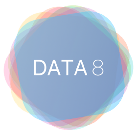{.title-logo fig-alt="Data 8 logo"}

:::: {.columns}
::: {.column width="50%"}
- Introductory course open to students in any major
- No prerequisites in programming or statistics
- Real questions and real data from the first lecture
- Python introduced as students need it, inside notebooks
:::

::: {.column width="50%"}
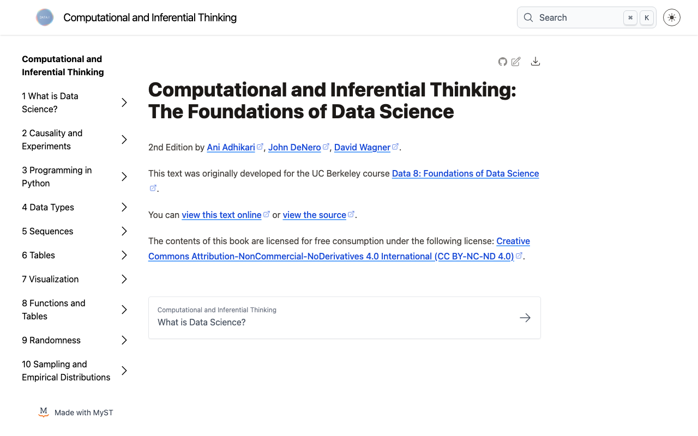{.shot fig-alt="Computational and Inferential Thinking, the open Data 8 textbook"}
:::
::::

[Open textbook: Adhikari, DeNero and Wagner, *Computational and Inferential Thinking*, inferentialthinking.com]{.caption}

::: notes
- Pilot in fall 2015
- Credit Ani Adhikari, John DeNero, David Wagner
- Current enrollment per semester (check figure)
:::

## The Data Science Connectors model

:::: {.columns}
::: {.column width="50%"}
- Connector courses are taken alongside Data 8
- Each one applies the same tools to a single discipline
- Faculty in that discipline design and teach them
- Students see the methods used on questions from their own field
:::

::: {.column width="50%"}
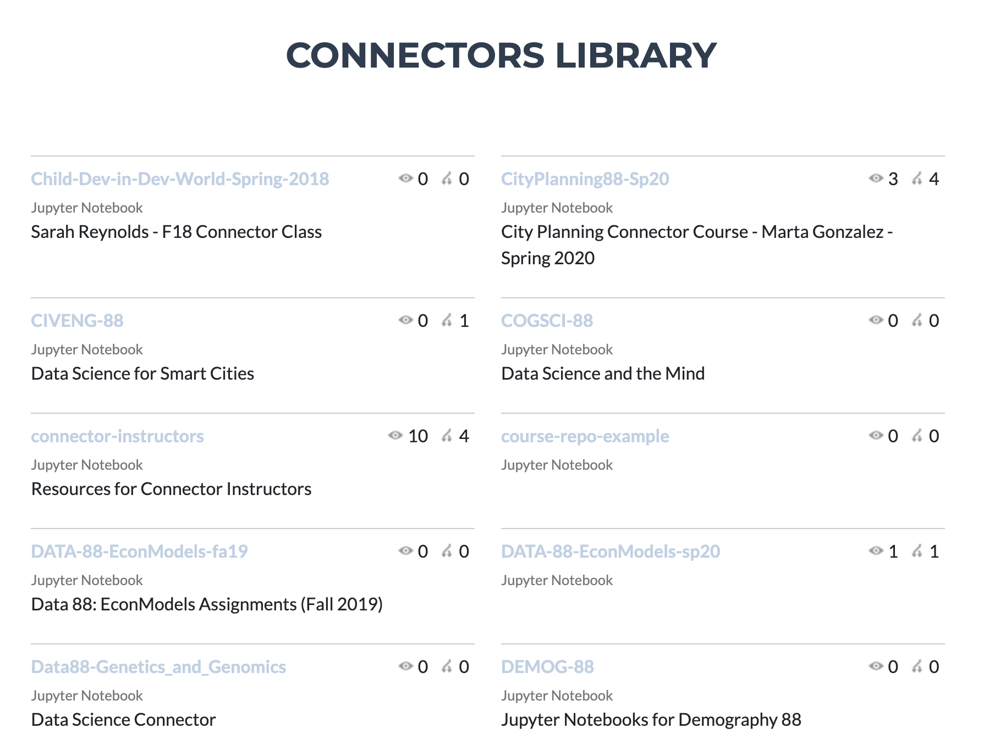{.shot fig-alt="Connectors Library listing course notebook repositories: Child Development in the Developing World, City Planning, Civil Engineering, Cognitive Science, Data 88 Economic Models, Genetics and Genomics, Demography"}
:::
::::

[Connectors Library: public notebook repositories for connector courses]{.caption}

::: notes
- Examples on screen: child development (Sarah Reynolds), city planning (Marta Gonzalez), smart cities, cognitive science, genetics, demography, Data 88E
- This is the model closest to what UEM faculty could do
:::

## Data 88E: Economic Models

:::: {.columns}
::: {.column width="45%"}
- A connector course in economics
- Economic models taught through notebooks
- Students work with economic data alongside the theory
- Open materials that other institutions have adapted
:::

::: {.column width="55%"}
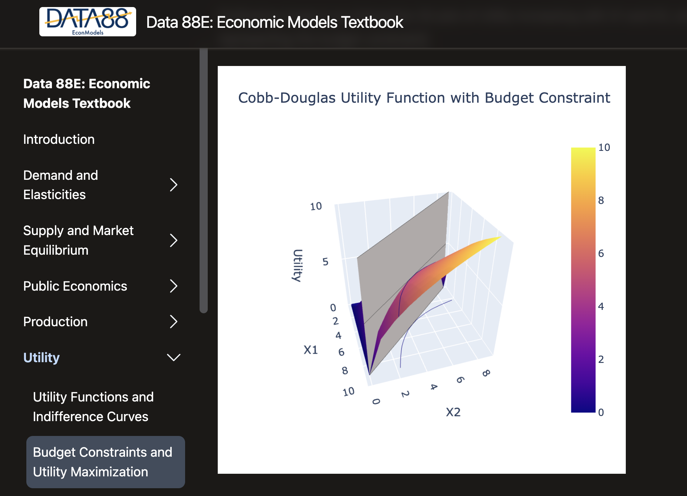{.shot fig-alt="Data 88E Economic Models Textbook page showing an interactive 3D plot of a Cobb-Douglas utility function with a budget constraint"}
:::
::::

[*Data 88E: Economic Models Textbook*, Budget Constraints and Utility Maximization. [data-88e.github.io/textbook](https://data-88e.github.io/textbook)]{.caption}

::: notes
- My own course; credit co-instructors
- On screen: Cobb-Douglas utility with a budget constraint, an interactive plot students can rotate
- Textbook sections: demand and elasticities, supply and equilibrium, public economics, production, utility
- Mention adopting institutions if appropriate
:::

## Ten years of notebooks at Berkeley

::: {.cards .stats}
:::: {.columns}
::: {.column}
### 10

years of notebook-based courses
:::
::: {.column}
### Dozens

of faculty teaching with notebooks
:::
::: {.column}
### Hundreds

of notebooks in open course materials
:::
::: {.column}
### 10,000s

of students
:::
::::
:::

::: {.bottom-question}
Most of this growth came from faculty in other departments adapting materials they had seen working.
:::

::: notes
- DataHub: cloud notebooks for every student, no installs
- 5 min for the Berkeley section
:::

## Start from your existing assignments

::: {.hflow}
- Excel exercise or lab book
- Same question in a notebook
- Same learning goal
:::

- Begin with an assignment you already teach and trust
- Keep the question and the data; change the tool
- The learning goals of the course stay the same

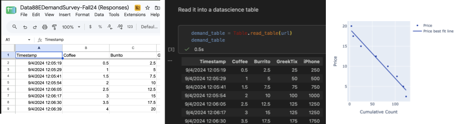{.shot fig-alt="Class demand survey responses in a Google Sheet, the same data read into a table in a notebook, and the resulting demand curve of price against cumulative count with a best-fit line"}

[Data 88E, fall 2024: class demand survey in a spreadsheet, read into a notebook, plotted as a demand curve]{.caption}

::: notes
- Design principles section: 8 min across four slides
- Example: students answer a willingness-to-pay survey in Google Sheets (coffee, burrito, Greek theater tickets, iPhone)
- Same data read into a table with one line of code, then plotted as the class demand curve
:::

## Teach only the Python needed

- Introduce code inside the notebook, at the point where it is used
- A few operations cover most course work: load a table, select, group, plot
- Give students working code to read and modify before they write their own
- Leave programming courses to teach programming

::: {.bottom-question}
How much Python does your course actually need?
:::

::: notes
- In Data 8, students use one table library for the whole semester
- Ask the room to think of one assignment
:::

## Learning a new Python package

::: {.hflow}
- Read the docs
- Supply data
- Configure
- Run
- Interpret
:::

- In Econ 148, students meet new data and ML packages every few weeks and learn to use them productively.
  - NumPy → statsmodels → scikit-learn
- AI tools expose similar Python interfaces and APIs, and the same pattern applies.
  - PyTorch, TensorFlow, the OpenAI API

::: {.bottom-question}
Moving through the Data Science major is a progression of learning new Python packages.
:::

::: {.logo-row}
{fig-alt="Jupyter"}
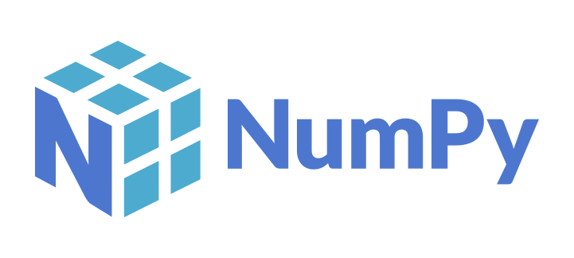{fig-alt="NumPy"}
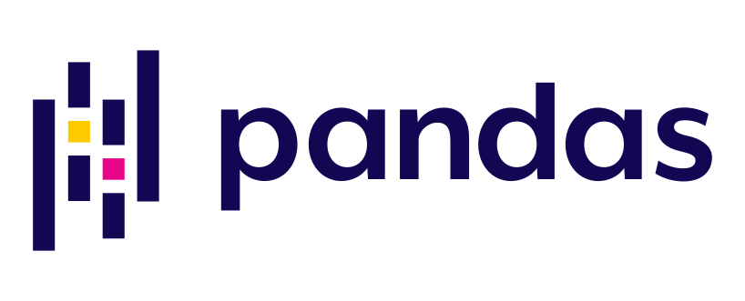{fig-alt="pandas"}
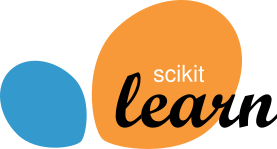{fig-alt="scikit-learn"}
{.logo-sm fig-alt="PyTorch"}
:::

::: notes
- The pattern is the transferable skill, not the package
- Next slide is the concrete example
:::

## Scaffold to the students' level

::: {.stairs}
::: {.rung .r1}
[1]{.rung-num}

### Run and read

Students run prepared cells and interpret the output.
:::
::: {.rung .r2}
[2]{.rung-num}

### Modify

Students change a variable, a filter or a time period and explain the difference.
:::
::: {.rung .r3}
[3]{.rung-num}

### Write

Students write their own analysis on a new question.
:::
:::

::: notes
- The same notebook can serve all three levels
- First year: mostly level 1 and 2
- Today's demo works at levels 1 and 2
:::

## Feedback through autograding

:::: {.columns}
::: {.column width="45%"}
- Tests are written into the notebook
- Students check their work as they go
- Instructors grade at scale with the same tests
- Berkeley uses otter-grader, which is open source
:::

::: {.column width="55%"}
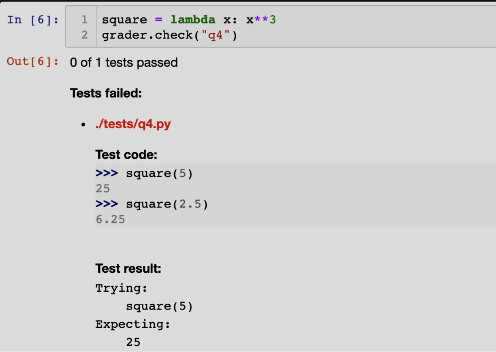{.shot fig-alt="Notebook cell running grader.check on question 4: a function named square that cubes its input fails the test, which shows the test code and the expected value of 25 for square(5)"}
:::
::::

[otter-grader: otter-grader.readthedocs.io]{.caption}

::: notes
- Feedback while working, not a week later
- On screen: student wrote x**3 for square; grader.check("q4") shows the failing test and the expected 25
- Written questions still graded by people
:::

## Metacognition 1: Notebook-based instruction

:::: {.columns}
::: {.column width="48%"}
- Code, narrative, data, visualizations and results in one environment
- Students start with real questions and working examples, then modify them
- Programming and math concepts arrive in the context of a substantive problem
:::
::: {.column width="52%"}
{.shot fig-alt="Computational and Inferential Thinking, the open Data 8 textbook"}

[inferentialthinking.com]{.caption}
:::
::::

::: {.bottom-question}
Is notebook-based instruction changing the way we teach computing, math and science?
:::

::: notes
- Data 8 as the example
- The same approach extends to experimenting with AI models and inference
:::

## Metacognition 2: Why are we learning this way?

::: {.statement}
Jupyter, NumPy, Python APIs and cloud environments are not only classroom conveniences.
:::

::: {.statement-2}
They are part of the scientific and professional computing ecosystem.
:::

- Students learn to explore, troubleshoot, adapt and build with the same tools professionals use.
- Students can adapt to new technologies as they emerge.
- Notebooks suit project-based learning and work in small teams, but you have to teach some key behaviors.
- *Faculty need to keep evolving the curriculum to reflect changes in the professional ecosystem.*

::: notes
- Ask the room: why are we learning this way?
- Connect the choice of tools to long-term adaptability
:::

## Metacognition 3: Teaching through the open-source stack

::: {.statement}
Data Science courses teach with open-source tools, so students learn the same stack used in research and industry.
:::

::: {.cards}
:::: {.columns}
::: {.column}
### Origins
IPython and Jupyter grew out of scientific computing and open research communities.
:::
::: {.column}
### An open stack
Python, NumPy, pandas and Jupyter are open-source projects maintained by communities.
:::
::: {.column}
### Reproducibility
Notebooks make methods and outputs shareable. Reproducing them also depends on environments, dependencies, data access and execution order.
:::
::::
:::

::: {.bottom-question}
I publish all my materials openly on the web, using only public data and images. I want academia to become more open.
:::

::: notes
- Teaching open source is part of the curriculum, not only a choice of tools
- Fernando Pérez, IPython at Berkeley roots
- Transparent workflows matter more as AI systems spread
:::

## Jupyter at UEM today

::: {.cards}
:::: {.columns}
::: {.column}
### Gabriel Marín Díaz

Open data courses and reproducible articles
:::
::: {.column}
### Marcos López-Caniego Alcarria

Notebooks for ESA Euclid mission data
:::
::: {.column}
### Javier Acosta

AlphaFold peptide design challenge on Google Cloud
:::
::::
:::

::: {.bottom-question}
Also in development: courses by María Cruz Gaya López and José Naveiro.
:::

::: notes
- Thank colleagues for sharing materials
- UEM section: 10 min
:::

## Euclid notebooks: Marcos López-Caniego

:::: {.columns}
::: {.column width="50%"}
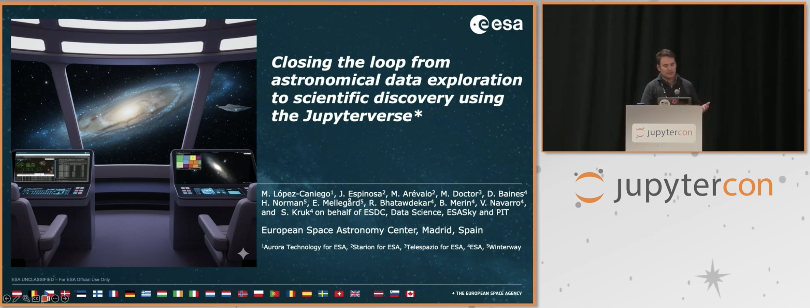{.shot fig-alt="JupyterCon talk by M. López-Caniego and colleagues, European Space Astronomy Centre, Madrid: Closing the loop from astronomical data exploration to scientific discovery using the Jupyterverse"}
:::

::: {.column width="50%"}
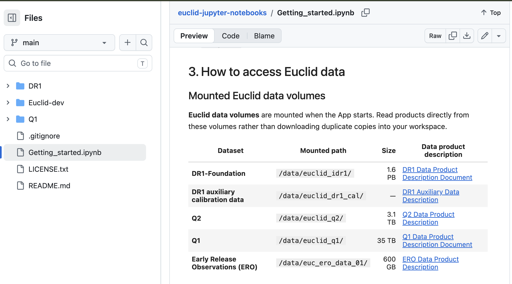{.shot fig-alt="Getting_started.ipynb in the euclid-jupyter-notebooks repository, section How to access Euclid data, with a table of mounted data volumes and their sizes"}
:::
::::

- JupyterCon talk on astronomical data exploration with Jupyter
- Getting-started notebooks for ESA Euclid mission data

[López-Caniego et al., "Closing the loop from astronomical data exploration to scientific discovery using the Jupyterverse," JupyterCon. European Space Astronomy Centre, Madrid. [youtube.com/watch?v=VKOz1v3bFVk](https://www.youtube.com/watch?v=VKOz1v3bFVk)]{.caption}

::: notes
- Notebooks as documentation others can run
- Euclid data volumes are mounted for users: DR1 is 1.6 PB, Q1 35 TB
- Credit co-authors on behalf of ESDC, Data Science, ESASky
:::

## Peptide design challenge: Javier Acosta {.profile-slide}

:::: {.columns}
::: {.column width="55%"}
- Third-year Biomedicine, Biotechnology and Pharmacy students
- 18 mixed teams, each with a disease-linked target
- Peptide design with AlphaFold in a Colab notebook on Google Cloud
- Selected teams defended their results
:::

::: {.column width="45%"}
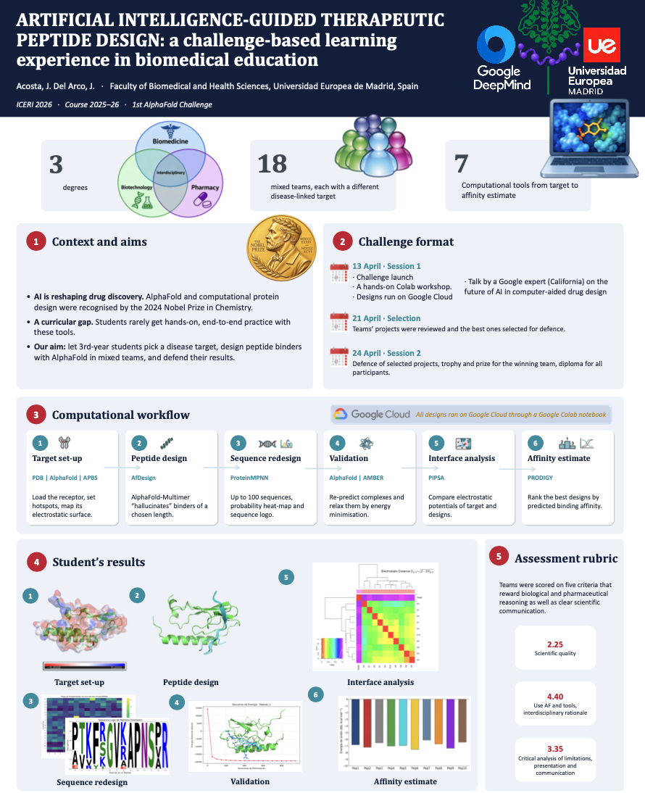{.shot fig-alt="Poster: Artificial intelligence-guided therapeutic peptide design, a challenge-based learning experience in biomedical education, showing the challenge format, a six-step computational workflow and student results"}
:::
::::

[Acosta and Del Arco, "Artificial intelligence-guided therapeutic peptide design: a challenge-based learning experience in biomedical education," ICERI 2026.]{.caption}

::: notes
- 1st AlphaFold Challenge, course 2025-26; credit J. Del Arco as co-author
- Sessions: 13 April launch and Colab workshop, 21 April selection, 24 April defence
- Workflow: target set-up, AfDesign, ProteinMPNN, AlphaFold and AMBER validation, PIPSA, PRODIGY affinity
- Talk by a Google expert on AI in drug design
- Notebooks reaching larger compute; leads into LORCA
:::

## Courses in development at UEM

::: {.cards}
:::: {.columns}
::: {.column}
### María Cruz Gaya López

Computación Científica I: from a CSV file to an analysis project, using NASA's Meteorite Landings open data

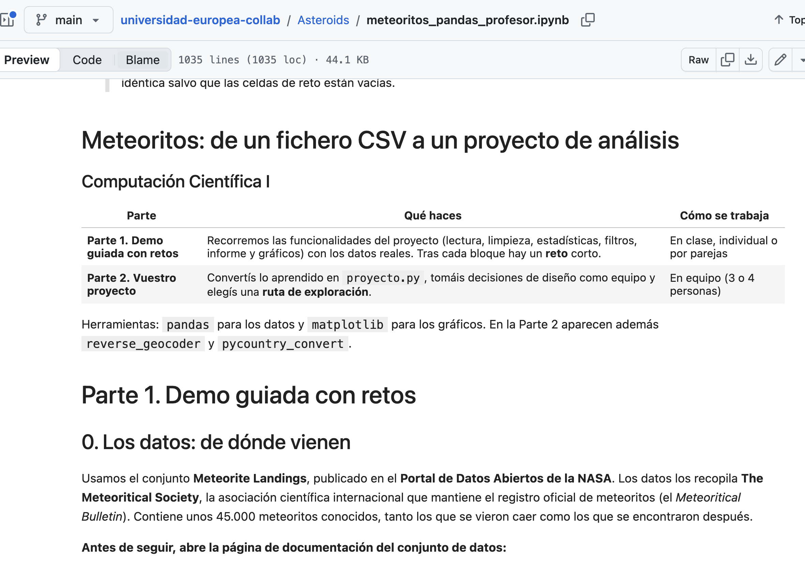{.shot fig-alt="Notebook meteoritos_pandas_profesor.ipynb, Computación Científica I: Meteoritos, de un fichero CSV a un proyecto de análisis, with a guided demo part and a team project part, using pandas and matplotlib"}
:::
::: {.column}
### José Naveiro

Metal cutting: cutting speed and spindle speed for turning a steel shaft, calculated step by step

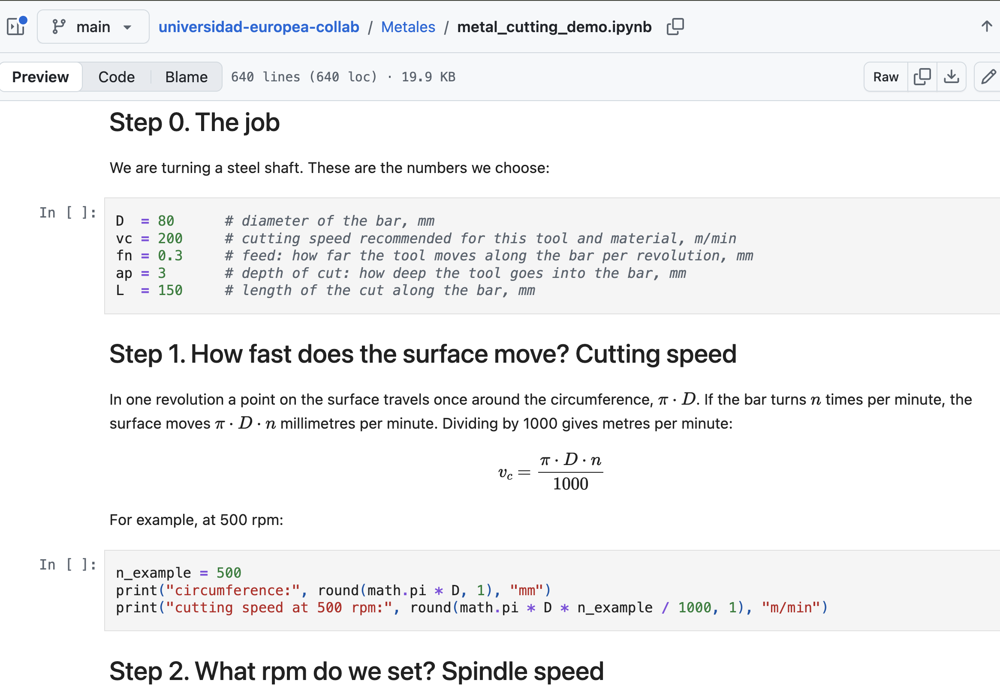{.shot fig-alt="Notebook metal_cutting_demo.ipynb: Step 0 sets the bar diameter, cutting speed, feed, depth and length; Step 1 derives cutting speed from diameter and rpm"}
:::
::::
:::

[Notebooks in the universidad-europea-collab repository on GitHub]{.caption}

::: notes
- Cruz: two parts, guided demo with short challenges, then team projects of 3 or 4; about 45,000 meteorites; pandas and matplotlib
- Naveiro: engineering example, formulas and code side by side
- Both shared in the universidad-europea-collab repo
- Invite others in the room to join this group
:::

## From notebook to LORCA

::: {.hflow}
- Notebook in Colab
- Jupyter on LORCA
- Research computing
:::

:::: {.columns}
::: {.column width="50%"}
- LORCA: Laboratorio Optimizado de Recursos de Computación Avanzada
- Students who can use Jupyter and Python can use LORCA
- 16 nodes with 1,200 CPU cores, 1.9 TB of RAM, 42 TB of storage and 10 NVIDIA GPUs
:::

::: {.column width="50%"}
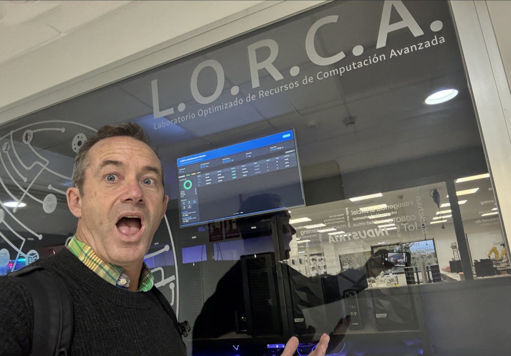{.shot fig-alt="Eric Van Dusen in front of the glass wall of the LORCA lab at Universidad Europea, with the LORCA infrastructure monitor on a screen behind the glass"}
:::
::::

::: notes
- Photo from my visit to LORCA
- Same notebook interface, more compute
- Access process for faculty and students
- Who to contact for LORCA access
- 4 min
:::

## Hands-on {.section-dark background-color="#061436"}

Reproducing a chart about the Spanish economy

## How to get to the notebook

[github.com/ericvd-ucb](https://github.com/ericvd-ucb){.big-link}

::: {.hflow}
- universidad-europea-collab repo
- README
- Open in Colab link
:::

- Sign in with a Google account
- Nothing to install

[[github.com/ericvd-ucb/universidad-europea-collab](https://github.com/ericvd-ucb/universidad-europea-collab)]{.caption}

::: notes
- Leave this slide up while people connect
- Fallback: pre-run notebook on my laptop if Wi-Fi or accounts fail
- 3 min
:::

## Some notes on Colab

::: {.cards}
:::: {.columns}
::: {.column}
### No sense of paths

Be careful how you address files that go with the notebook.

I point to files by their address on GitHub.
:::
::: {.column}
### AI help built in

Colab has an AI assistant installed.

It will suggest code as you type.
:::
::: {.column}
### Good for group work

Share one notebook with a group.

Students can work in it together.
:::
::::
:::

::: notes
- Show a GitHub raw file URL in the notebook as the example
- Decide with students when to use the AI suggestions
:::

## Can we reproduce this chart? {.profile-slide}

:::: {.columns}
::: {.column width="45%"}
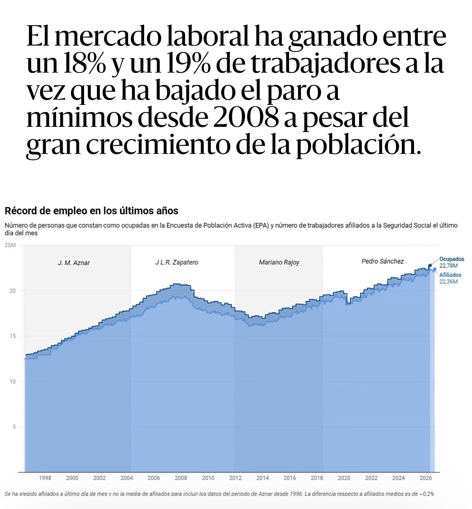{.shot fig-alt="Spanish news graphic: headline says the labor market has gained 18 to 19 percent more workers while unemployment fell to its lowest since 2008; area chart of employed persons (EPA) and Social Security affiliates from 1996 to 2026, shaded by the terms of Aznar, Zapatero, Rajoy and Sánchez"}
:::

::: {.column width="55%"}
- A chart of employment in Spain by presidential term, shared on social media and in the press
- Two series: employed persons in the EPA survey and workers registered with Social Security
- We will find the data, rebuild the chart and check the headline
:::
::::

::: {.bottom-question}
The question is about data and careful reading, not about politics.
:::

[El Diario, Instagram post. [instagram.com/p/DeXZ-VrGlI6](https://www.instagram.com/p/DeXZ-VrGlI6/)]{.caption}

::: notes
- Source: El Diario, Instagram
- Headline: 18 to 19% more workers, unemployment lowest since 2008, despite population growth
- Latest values on the chart: 22.78M employed (EPA), 22.36M affiliates
- Footnote: affiliates measured on the last day of the month to reach back to 1996
- Connects to Marín's reproducibility work
:::

## Notebook basics in Colab

:::: {.columns}
::: {.column width="55%"}
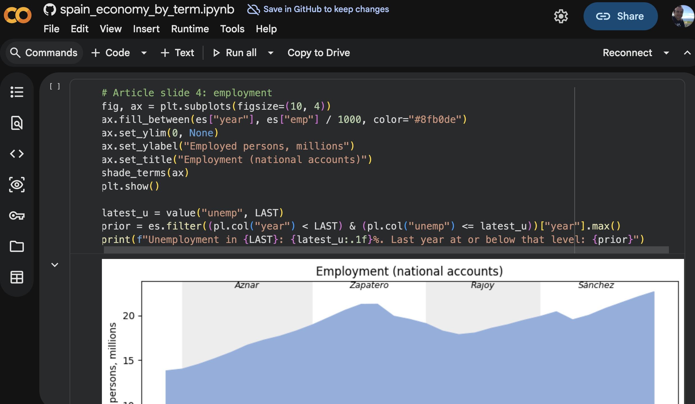{.shot fig-alt="spain_economy_by_term.ipynb open in Google Colab, with the toolbar showing Code, Text, Run all and Copy to Drive, a code cell that plots employment, and the resulting chart shaded by the terms of Aznar, Zapatero, Rajoy and Sánchez"}
:::

::: {.column width="45%"}
- Text cells and code cells
- Run a cell with Shift + Enter
- Run cells in order, from the top
- Save a copy to your own Drive
:::
::::

::: notes
- Everyone runs the first cell together
- Point out "Copy to Drive" and "Run all" in the toolbar
- On screen: the employment chart rebuilt from national accounts data, shaded by term
:::

## Steps for the session

::: {.flow .flow-navy}
- Open spain_economy_by_term.ipynb from the README
- Run the cells that load the data
- Reproduce the published chart
- Change an indicator or time period
- Discuss how you would adapt this for your course
:::

::: notes
- Roughly 5, 10, 10, 10, 5 minutes
- Show the reproduced chart (spain-reproduced-chart.png) if time is short
:::

## Discussion

::: {.statement}
How would you adapt this for your own course?
:::

- Which existing assignment could become a notebook?
- What data do your students already use?
- What would students need to know first?

[Materials: github.com/ericvd-ucb/universidad-europea-collab]{.caption}

::: notes
- Collect names of interested faculty
- Offer follow-up help with a first notebook
:::
