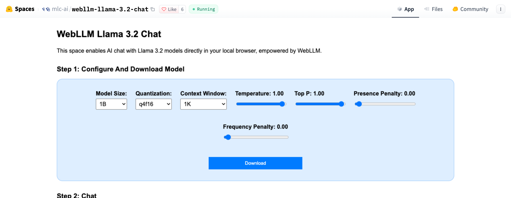
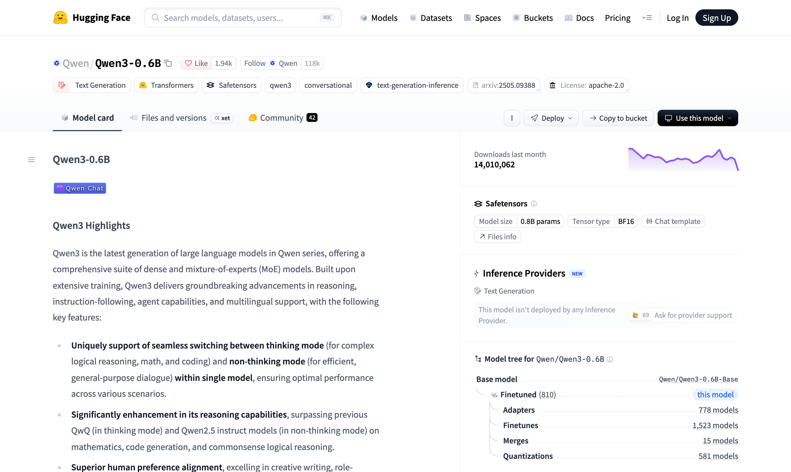

## Why small models for a data science class

- **No keys, no bills.** A real language model with no account, API key, or per-token charge.
- **Data stays local.** Prompts and records never leave the student's laptop.
- **Opens from a link.** JupyterLite runs entirely in the browser: no server, no install.
- **Small enough to study.** Tokens, sampling, templates, and failures are all open to inspection.

::: {.statement}
The aim is not a better chatbot. It is a model students can take apart.
:::

::: {.notes}
Third-year DS students: frame as a tool they can measure, not a product. Mention Lab 42 demo.
:::

## What runs where

```{mermaid}
flowchart LR
  A["Python cell<br/>JupyterLite (Pyodide)"] --> B["WebLLM engine<br/>OpenAI-style API"]
  B --> C["WebGPU<br/>laptop GPU"]
  D["Hugging Face<br/>model weights"] -. "download once, then cache" .-> B
```

- Python calls into WebLLM through the Pyodide JavaScript bridge
- WebGPU gives the browser access to the laptop's graphics chip
- The first load downloads the model; later loads read it from the browser cache

::: {.note}
Requires a browser with WebGPU support, such as a recent Chrome or Edge.
:::

::: {.notes}
Warn about first download on campus wifi. Have the model cached before class.
:::

## Try it: WebLLM chat on Hugging Face

{.shot fig-align="center" height="270" fig-alt="WebLLM Llama 3.2 Chat Space on Hugging Face, with settings for model size, quantization, context window, temperature and top p, and a Download button"}

- Download a Llama 3.2 model into the browser, then chat with it
- Temperature and top p return later as Python arguments

::: {.note}
[huggingface.co/spaces/mlc-ai/webllm-llama-3.2-chat](https://huggingface.co/spaces/mlc-ai/webllm-llama-3.2-chat), built by the MLC team with WebLLM
:::

::: {.notes}
- Open the link live; start the 1B model download early
- Same WebLLM engine as the JupyterLite notebooks, with no Python
:::

# Where models come from {.section background-color="#0F1E3A"}

From a research lab to a student's laptop

## From a lab to a laptop

::: {.incremental}
1. **Pretrain.** A lab trains a network to predict the next token on a large text corpus.
2. **Instruction-tune.** Further training on dialogues teaches it to follow instructions and chat.
3. **Release.** Weights, tokenizer, and a model card are published on Hugging Face.
4. **Quantize.** Weights are compressed from 16-bit to 4-bit numbers.
5. **Compile.** MLC turns the model into code that runs on WebGPU.
6. **Download.** The browser fetches the files and caches them.
:::

::: {.notes}
Steps 1 to 3 are the lab; 4 to 6 are the community and the runtime. Different organisations, different licenses.
:::

## A model card on Hugging Face

{.shot fig-align="center" height="430" fig-alt="Hugging Face model card for Qwen/Qwen3-0.6B, showing tags, the Apache 2.0 license, 0.8B parameters, monthly downloads and the model tree"}

::: {.note}
Qwen3-0.6B from Alibaba's Qwen team: [huggingface.co/Qwen/Qwen3-0.6B](https://huggingface.co/Qwen/Qwen3-0.6B)
:::

::: {.notes}
- Open the page live
- Point to: Apache 2.0 license tag, 0.8B parameters in BF16, chat template
- Model tree: base model, fine-tunes, and quantizations; the MLC build in the notebooks is one of the quantizations
:::

## Reading a model name

::: {.big-id}
Qwen3-0.6B-q4f16_1-MLC
:::

| Part | Meaning |
|------|---------|
| `Qwen3` | Model family and version (Alibaba's Qwen 3) |
| `0.6B` | 0.6 billion parameters (the learned weights) |
| `q4f16_1` | 4-bit weights, 16-bit floating-point arithmetic |
| `MLC` | Compiled for the MLC and WebLLM runtime |

::: {.note}
"Instruct" or "-it" in a name marks a chat-tuned model; a base model only continues text. The files live at huggingface.co/mlc-ai/Qwen3-0.6B-q4f16_1-MLC.
:::

## Choosing a model for a class

| Model | Parameters | Rough 4-bit size\* | Good for |
|-------|-----------:|-------------------:|----------|
| SmolLM2-360M-Instruct | 0.36 B | about 0.2 GB | Fast demos; seeing failure modes |
| Qwen3-0.6B | 0.6 B | about 0.3 GB | Default starter; visible reasoning |
| Llama-3.2-1B-Instruct | 1.2 B | about 0.6 GB | Solid general chat |
| Qwen3-1.7B | 1.7 B | about 0.9 GB | Better answers, still laptop-friendly |
| Phi-3.5-mini-instruct | 3.8 B | about 1.9 GB | Strongest here; needs a capable GPU |

: {tbl-colwidths="[34,14,20,32]"}

```python
ids = [m.model_id for m in webllm.prebuiltAppConfig.model_list]
```

::: {.note}
\*Estimate: parameters × 0.5 bytes. Actual downloads are somewhat larger. Start with the smallest model whose failures are still instructive.
:::

::: {.notes}
Check exact IDs against prebuiltAppConfig before class; the list changes between WebLLM releases.
:::

## The model card is a dataset card

:::: {.columns}
::: {.column width="50%"}
- **License:** may it be used, modified, redistributed?
- **Training data:** what text, which languages, what cutoff?
- **Intended use:** what the developers built it for
:::
::: {.column width="50%"}
- **Limitations and bias:** failures the developers report
- **Evaluation:** which benchmarks, compared against what
- **Chat template:** the exact format the model expects
:::
::::

::: {.statement}
For an open data class, the model card raises the same questions as any data source: provenance, license, and fitness for purpose.
:::

# The OpenAI chat interface {.section background-color="#0F1E3A"}

One request format across cloud, laptop, and browser

## One call shape, three backends

:::: {.columns}
::: {.column width="50%"}
```python
from openai import OpenAI

# Cloud
client = OpenAI()

# Laptop, with Ollama
OLLAMA = "http://localhost:11434/v1"
client = OpenAI(
    base_url=OLLAMA, api_key="ollama"
)

reply = client.chat.completions.create(
    model="qwen3:0.6b",
    messages=messages,
)
```
:::
::: {.column width="50%"}
```python
# Browser, with WebLLM in JupyterLite
engine = await webllm.CreateMLCEngine(
    "Qwen3-0.6B-q4f16_1-MLC"
)

create = engine.chat.completions.create
request = js_obj(
    {"messages": messages}
)
reply = await create(request)
```

::: {.note}
In WebLLM the model is chosen when the engine loads, so the `model` argument is not used.
:::
:::
::::

## Connecting Python to WebLLM

```python
import js
from pyodide.ffi import to_js

if getattr(js.navigator, "gpu", None):
    print("WebGPU is available. You can run models.")

webllm = await js.eval("import('https://esm.run/@mlc-ai/web-llm')")
engine = await webllm.CreateMLCEngine("Qwen3-0.6B-q4f16_1-MLC")

def js_obj(d):
    """Turn a Python dict into a JavaScript object."""
    return to_js(d, dict_converter=js.Object.fromEntries)

async def chat(messages, **settings):
    """Send a conversation and return the reply."""
    request = js_obj({"messages": messages, **settings})
    return await engine.chat.completions.create(request)
```

::: {.note}
Simplified from webllm_starter.ipynb, which adds a download progress bar and the browser model cache. All of the code is visible in the notebook.
:::

::: {.notes}
Point out js_obj: the model runs in JavaScript, so Python dicts must be translated on the way in.
:::

## Anatomy of a request

```{.python code-line-numbers="|2-5|6-7|9"}
reply = await chat(
    messages=[
        {"role": "system", "content": "You are a concise tutor."},
        {"role": "user", "content": "What is a token?"},
    ],
    temperature=0.7,
    max_tokens=200,
)
print(reply.choices[0].message.content)
```

- **Messages:** the whole conversation, as a list of role and content pairs
- **Settings:** how each next token is chosen and when to stop
- **Reply:** the text sits inside a nested structure that must be unpacked

## Three roles, one list

- **system:** sets behaviour for the whole conversation; written by the developer
- **user:** what the person types
- **assistant:** what the model said before

```python
history.append({"role": "user", "content": question})
reply = await chat(history)
answer = reply.choices[0].message.content
history.append({"role": "assistant", "content": answer})
```

::: {.statement}
The model is stateless. Memory is the notebook resending the history on every turn.
:::

## Anatomy of a response

:::: {.columns}
::: {.column width="55%"}
```json
{
  "model": "Qwen3-0.6B-q4f16_1-MLC",
  "choices": [{
    "index": 0,
    "message": {
      "role": "assistant",
      "content": "A token is..."
    },
    "finish_reason": "stop"
  }],
  "usage": {
    "prompt_tokens": 27,
    "completion_tokens": 64,
    "total_tokens": 91
  }
}
```
:::
::: {.column width="45%"}
- **choices:** a list, because one request can ask for several replies
- **finish_reason:** `"stop"` means the model ended; `"length"` means `max_tokens` cut it off
- **usage:** token counts, the unit of cost, speed, and context limits
:::
::::

::: {.notes}
Token counts illustrative. Read fields with dots, reply.choices[0].message.content, exactly as with the OpenAI Python client. pprint(reply.to_py()) shows the whole thing, as in the starter notebook.
:::

# The harness {.section background-color="#0F1E3A"}

Before, during, and after the call: parsing input and output

## The model is one function

```{mermaid}
flowchart LR
  A["Open data<br/>DataFrame row"] --> B["Prompt<br/>template"]
  B --> C["Model<br/>call"]
  C --> D["Text<br/>reply"]
  D --> E["Parsed<br/>fields"]
  E --> F["New<br/>columns"]
```

- **Before:** turn data into a prompt
- **During:** run the call, measure it, handle errors
- **After:** turn text back into data, and check it

::: {.statement}
Most of the work, and most of the errors, sit outside the model.
:::

## Before: building the input

```python
import pandas as pd
df = pd.read_csv("[dataset].csv")   # open data with a free-text column

SYSTEM = "You extract fields from city service requests. Reply with JSON only."

def build_messages(text):
    prompt = f"""Request: {text}
Return JSON with keys "category" and "urgency" (low, medium, or high)."""
    return [
        {"role": "system", "content": SYSTEM},
        {"role": "user", "content": prompt},
    ]
messages = build_messages(df["texto"].iloc[0])
```

- The prompt is a template; the data fills it in
- Check the fit (roughly one token per four characters of English), and use `temperature=0` for extraction

## During: running the call

```python
import time

start = time.perf_counter()
reply = await chat(messages, temperature=0, max_tokens=100)
elapsed = time.perf_counter() - start

tokens = reply.usage.completion_tokens
print(f"{tokens / elapsed:.1f} tokens per second")
```

- Every call is a measurement: time, tokens in, tokens out
- Students compare models and laptops with their own numbers

## During: streaming and batches

:::: {.columns}
::: {.column width="50%"}
**Streaming:** see tokens as they arrive

```python
create = engine.chat.completions.create
request = js_obj({
    "messages": messages,
    "stream": True,
})
stream = await create(request)
async for chunk in stream:
    delta = chunk.choices[0].delta
    if delta.content:
        print(delta.content, end="")
```
:::
::: {.column width="50%"}
**Batches:** one call per row, with retries

```python
replies = []
for text in df["texto"].head(20):
    msgs = build_messages(text)
    for attempt in range(3):
        try:
            r = await chat(msgs)
            break
        except Exception:
            r = None
    replies.append(r)
```
:::
::::

## After: parsing the output

```python
import json, re

def clean(text):
    # drop a Qwen3 reasoning block, then any code fences
    text = re.sub(r"<think>.*?</think>", "", text, flags=re.S)
    text = re.sub(r"^```(json)?|```$", "", text.strip(), flags=re.M)
    return text.strip()

def parse(reply):
    choice = reply.choices[0]
    if choice.finish_reason != "stop":
        return None          # cut off: do not trust it
    try:
        return json.loads(clean(choice.message.content))
    except json.JSONDecodeError:
        return None          # count it as a failure
```

- Small models often wrap JSON in fences or add commentary
- A failed parse is data too: record it rather than hiding it

## After: checking and storing

```python
ALLOWED = {"low", "medium", "high"}

def valid(fields):
    return (
        isinstance(fields, dict)
        and isinstance(fields.get("category"), str)
        and fields.get("urgency") in ALLOWED
    )

parsed = [parse(r) if r else None for r in replies]
parsed = [p if valid(p) else None for p in parsed]

sample = df.head(20).copy()
sample["category"] = [p["category"] if p else None for p in parsed]
sample["urgency"] = [p["urgency"] if p else None for p in parsed]
```

::: {.statement}
Text in, a table out: the result is ordinary data, ready for pandas.
:::

## Asking for structure

```python
schema = {
    "type": "object",
    "properties": {
        "category": {"type": "string"},
        "urgency": {"enum": ["low", "medium", "high"]},
    },
    "required": ["category", "urgency"],
}

reply = await chat(
    messages,
    temperature=0,
    response_format={"type": "json_object", "schema": json.dumps(schema)},
)
```

- The engine constrains generation so the reply matches the schema
- Valid JSON is not a correct answer: validation still applies

::: {.note}
Backends spell this differently: the OpenAI API uses `{"type": "json_schema", ...}`.
:::

## Worked example: text in, table out

| texto | category | urgency |
|-------|----------|---------|
| Farola apagada en la calle desde hace una semana | street lighting | medium |
| Contenedor desbordado frente al colegio | waste collection | high |
| Banco del parque con pintura descascarillada | park furniture | low |

::: {.note}
Illustrative records. In class, use a free-text column from an open data portal such as datos.madrid.es or datos.gob.es.
:::

::: {.notes}
Point out the model reads Spanish and answers in English because the prompt asked for English keys. Ask students whether categories should be a fixed list.
:::

## Evaluating the harness

- Label a sample by hand, for example 30 rows
- Measure the parse rate and the accuracy

```python
parse_rate = sample["category"].notna().mean()
accuracy = (sample["urgency"] == sample["label"]).mean()
```

- Change one thing at a time: the prompt, the model, or the temperature
- Report failures alongside successes

::: {.statement}
The harness turns a demo into an experiment.
:::

# Behind the scenes {.section background-color="#0F1E3A"}

What happens inside a single call

## What happens inside the call

```{mermaid}
flowchart LR
  A["Messages"] --> B["Chat<br/>template"]
  B --> C["Tokenize"]
  C --> D["Prefill"]
  D --> E["Decode<br/>loop"]
  E --> F["Detokenize"]
```

The list of messages becomes one string with special tokens (Qwen's ChatML format):

```text
<|im_start|>system
You are a concise tutor.<|im_end|>
<|im_start|>user
What is a token?<|im_end|>
<|im_start|>assistant
```

::: {.note}
Each model family has its own template, which is why the model card matters.
:::

## One token at a time

1. Score every token in the vocabulary (the logits)
2. Rescale the scores by `temperature`
3. Keep only the most likely tokens, up to `top_p`
4. Sample one token and append it
5. Repeat until a stop token, a `stop` string, or `max_tokens`

::: {.note}
Prefill reads the whole prompt in one pass. Decode produces one token per step, which is the tokens-per-second figure students measured earlier.
:::

## Temperature reshapes the odds

:::: {.columns}
::: {.column width="52%"}
```python
import numpy as np

tokens = ["Paris", "Lyon", "the",
          "France", "a"]
logits = np.array([5, 3, 2.5, 2, 1.5])

def softmax(x, T):
    p = np.exp(x / T)
    return p / p.sum()

for T in [0.5, 1, 2]:
    print(T, softmax(logits, T).round(3))
```
:::
::: {.column width="48%"}
Next token after "The capital of France is"

| Token | T = 0.5 | T = 1 | T = 2 |
|-------|--------:|------:|------:|
| Paris | 97.2% | 77.1% | 48.7% |
| Lyon | 1.8% | 10.4% | 17.9% |
| the | 0.7% | 6.3% | 14.0% |
| France | 0.2% | 3.8% | 10.9% |
| a | 0.1% | 2.3% | 8.5% |

::: {.note}
Illustrative logits. At temperature 0 the engine always takes the top token.
:::
:::
::::

## The arguments worth teaching

| Argument | Values | What it does |
|----------|--------|--------------|
| `temperature` | 0 to 2 | Randomness of each pick; 0 is greedy |
| `top_p` | 0 to 1 | Sample only from the most likely tokens, up to total probability p |
| `max_tokens` | integer | Hard cap on reply length |
| `stop` | strings | Text that ends generation early |
| `seed` | integer | Repeatable sampling for the same model and settings |
| `stream` | true or false | Receive tokens as they are generated |
| `response_format` | JSON schema | Constrain the reply to valid JSON |
| `frequency_penalty`, `presence_penalty` | −2 to 2 | Discourage repetition |
| `logprobs` | true or false | Return token probabilities for inspection |

::: {.notes}
Connect back to the harness: truncated JSON is max_tokens; inconsistent labels is temperature.
:::

## The notebook series

| Notebook | Section of this talk |
|----------|----------------------|
| Starter sampler | Why small models |
| Finding and picking models | Where models come from |
| The chat format: roles, settings, JSON reply | The OpenAI chat interface |
| Memory: a chat that remembers | The OpenAI chat interface |
| The harness: parsing input and output (new) | The harness |
| Tokens: numbers all the way down | Behind the scenes |
| SAT test taker | Evaluation |

::: {.note}
github.com/ericvd-ucb/small-models-lite
:::

## Small models in the browser {.lite-slide}

:::: {.columns}
::: {.column width="34%" .lite-qr}
{fig-alt="QR code linking to the Small Models in the Browser site"}

**Try it on your laptop**

[small-models-lite](https://ericvd-ucb.github.io/small-models-lite/) on GitHub Pages

[small-models-xeus](https://notebook.link/github/ericvd-ucb/small-models-xeus/tree/main/lab/) on notebook.link
:::

::: {.column width="66%"}
{.lite-logo fig-alt="JupyterLite"}

A JupyterLite site where small language models run in the student's browser through WebLLM, with no server, API key or installation.

- Talking to models and generation settings
- Tokens, chunking and embeddings
- Memory with SQLite and embedding search
- Inside an open-weight model package

[Requires Chrome or Edge with WebGPU.]{.caption .left}
:::
::::

::: {.notes}
- Invite the audience to scan and try it after the talk
- The QR code opens the GitHub Pages site; the notebook.link version is the xeus build of the same notebooks
- First model download takes a few minutes, then it is cached
- Thanks to Jeremy Tuloup and the JupyterLite community
:::

## Takeaways

- Small models make the whole stack teachable, in a browser tab
- The OpenAI chat format is the common language across cloud, laptop, and browser
- The harness is ordinary data science: build inputs, call, parse, validate, evaluate
- Generation settings explain the failures students see in their own output

::: {.statement}
Questions and discussion
:::

{.end-logo height="170" fig-alt="Logo: a robot holding a tablet with the Hugging Face emoji, inside the Jupyter rings"}

::: {.note}
github.com/ericvd-ucb
:::
