## Economics, Python and AI: Skills for Analytics Work {.title-dark background-color="#061436"}

[Data 88E, Econ 148 and learning to work with models]{.subtitle}

::: {.byline}
**Eric Van Dusen**<br>
UE Alcobendas<br>
23 November 2026<br>
[github.com/ericvd-ucb](https://github.com/ericvd-ucb)
:::

::: {.title-logos}
{.berkeley-logo fig-alt="UC Berkeley"}
{.cdss-logo fig-alt="UC Berkeley College of Computing, Data Science, and Society"}
:::

::: notes
- Thank hosts by name
- 30 min, questions at the end
- Ask who has written Python, who has used an AI assistant for code
:::

## Plan for today

::: {.cards}
:::: {.columns}
::: {.column}
### Economics in notebooks

Data 8, Data 88E and Econ 148 at Berkeley
:::
::: {.column}
### Skills for jobs in the AI era

What keeps its value when AI writes code
:::
::: {.column}
### Step one: vibecoding

Building analyses with an AI assistant, and checking them
:::
::: {.column}
### Step two: small models

The harness that sits around every AI product
:::
::::
:::

::: notes
- Roughly 8, 6, 8, 8 minutes
- Links and QR codes at the end
:::

## Part 1 {.section-dark background-color="#061436"}

Economics in notebooks

## My path into notebooks {.profile-slide}

:::: {.columns}
::: {.column width="45%"}
- My background is in international development
- At Berkeley I started teaching a development course built on notebooks
- Students worked with field data from published studies in the first week
- That course led to Data 88E and Econ 148
:::

::: {.column width="55%"}
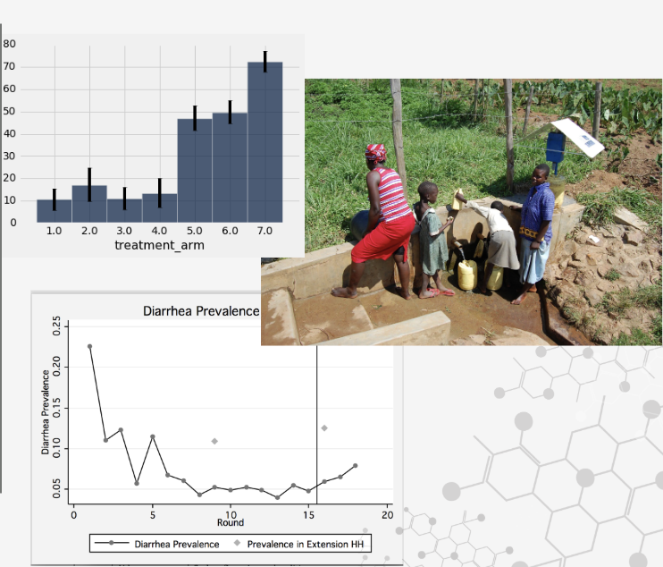{.shot fig-alt="Charts from development field data, outcomes by treatment arm and diarrhea prevalence by survey round, with a photo of a community water source"}
:::
::::

::: notes
- LS 88: Behind the Curtain in International Development
- WaterGuard study as the example dataset
- Came to teaching from development work, not from computer science
- 1.5 min
:::

## Data 8: Foundations of Data Science 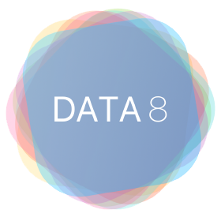{.title-logo fig-alt="Data 8 logo"}

:::: {.columns}
::: {.column width="50%"}
- Introductory course open to students in any major
- No prerequisites in programming or statistics
- Real questions and real data from the first lecture
- Python introduced as students need it, inside notebooks
:::

::: {.column width="50%"}
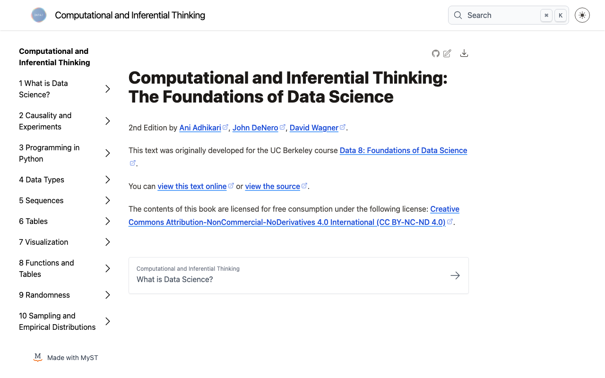{.shot fig-alt="Computational and Inferential Thinking, the open Data 8 textbook"}
:::
::::

[Open textbook: Adhikari, DeNero and Wagner, *Computational and Inferential Thinking*, inferentialthinking.com]{.caption}

::: notes
- Pilot in fall 2015
- Credit Ani Adhikari, John DeNero, David Wagner
- [VERIFY: current enrollment per semester before citing a number]
:::

## The Data Science Connectors model

:::: {.columns}
::: {.column width="50%"}
- Connector courses are taken alongside Data 8
- Each one applies the same tools to a single discipline
- Faculty in that discipline design and teach them
- Students see the methods used on questions from their own field
:::

::: {.column width="50%"}
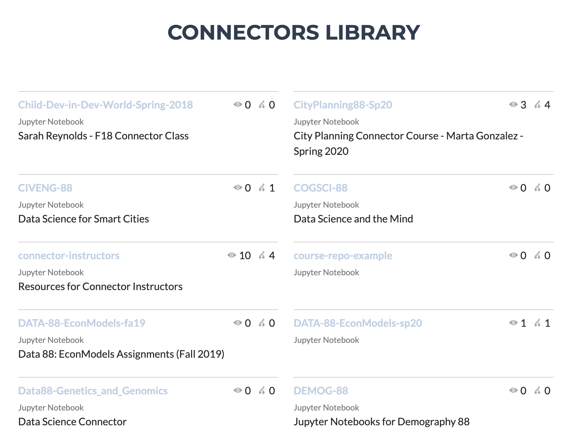{.shot fig-alt="Connectors Library listing course notebook repositories: Child Development in the Developing World, City Planning, Civil Engineering, Cognitive Science, Data 88 Economic Models, Genetics and Genomics, Demography"}
:::
::::

[Connectors Library: public notebook repositories for connector courses]{.caption}

::: notes
- Examples on screen: child development, city planning, cognitive science, genetics, demography, Data 88E
- Data 88E is the economics connector
:::

## Data 88E: Economic Models

:::: {.columns}
::: {.column width="45%"}
- A connector course in economics
- Economic models taught through notebooks
- Students work with economic data alongside the theory
- Open materials that other institutions have adapted
:::

::: {.column width="55%"}
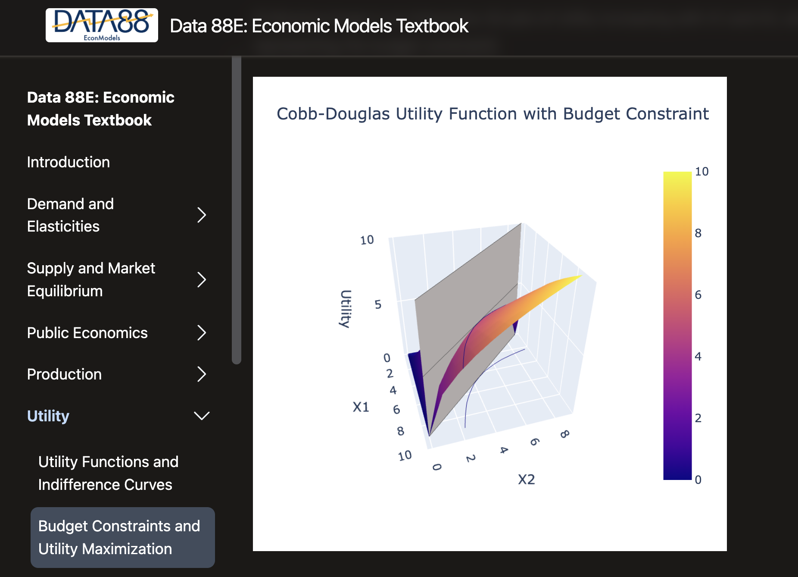{.shot fig-alt="Data 88E Economic Models Textbook page showing an interactive 3D plot of a Cobb-Douglas utility function with a budget constraint"}
:::
::::

[*Data 88E: Economic Models Textbook*, Budget Constraints and Utility Maximization. [data-88e.github.io/textbook](https://data-88e.github.io/textbook)]{.caption}

::: notes
- Credit co-instructors
- On screen: Cobb-Douglas utility with a budget constraint, an interactive plot students can rotate
- Sections: demand and elasticities, supply and equilibrium, public economics, production, utility
:::

## From a spreadsheet to a demand curve

::: {.hflow}
- Survey in a spreadsheet
- Table in a notebook
- Demand curve
:::

- Students answer a willingness-to-pay survey in Google Sheets
- The same data is read into a notebook with one line of code
- The class demand curve is plotted from their own answers

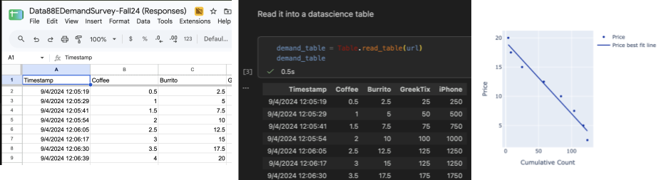{.shot fig-alt="Class demand survey responses in a Google Sheet, the same data read into a table in a notebook, and the resulting demand curve of price against cumulative count with a best-fit line"}

[Data 88E, fall 2024: class demand survey in a spreadsheet, read into a notebook, plotted as a demand curve]{.caption}

::: notes
- Items: coffee, burrito, Greek Theatre tickets, iPhone
- Many analytics tasks start in a spreadsheet; the notebook keeps every step visible and repeatable
:::

## Econ 148: Data Science for Economists

::: {.cards}
:::: {.columns}
::: {.column}
### Forecasting

ARIMA, Prophet and Chronos-2 on Zillow rent and CPI data
:::
::: {.column}
### ML fairness

Income prediction on Folktables and ACS data, with SHAP explanations
:::
::: {.column}
### Survival analysis

Time to reemployment for displaced workers, IPUMS CPS data with lifelines
:::
::::
:::

::: {.bottom-question}
Each unit puts a classic econometric method next to a newer model on the same data.
:::

::: notes
- Classic econometrics next to a foundation model on the same data
- Chronos-2: pretrained time series foundation model
- Students learn a new package every few weeks
:::

## Frequent assessment in Econ 148

:::: {.columns}
::: {.column width="45%"}
- Students practice pandas code on PrairieLearn
- Questions are randomized and graded automatically
- Feedback arrives right away, while students are still working on the problem
:::

::: {.column width="55%"}
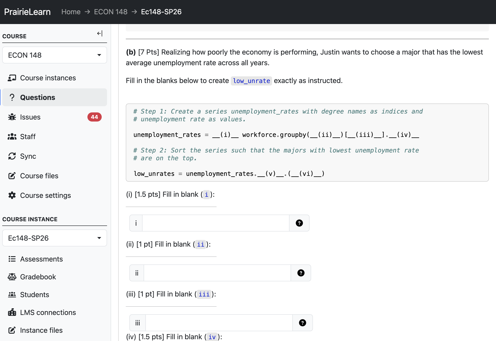{.shot fig-alt="PrairieLearn question from Econ 148, Spring 2026: fill in the blanks in pandas code"}
:::
::::

[[prairielearn.com](https://www.prairielearn.com). Question from Econ 148, Spring 2026.]{.caption}

::: notes
- Open-source platform from the University of Illinois
- Short, frequent quizzes; second-chance retakes
- 1 min
:::

## The Python stack

::: {.hflow}
- Read the docs
- Supply data
- Configure
- Run
- Interpret
:::

- Econ 148 students meet a new data or ML package every few weeks
  - NumPy, pandas, statsmodels, scikit-learn
- The same stack runs in Colab, Databricks and JupyterHub
- AI tools expose similar Python interfaces, and the same pattern applies

::: {.logo-row}
{fig-alt="Jupyter"}
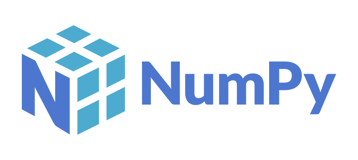{fig-alt="NumPy"}
{fig-alt="pandas"}
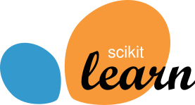{fig-alt="scikit-learn"}
{.logo-sm fig-alt="PyTorch"}
{fig-alt="Databricks"}
:::

::: notes
- The pattern is the transferable skill, not the package
- Databricks: notebooks on large data, common in industry analytics teams
:::

## Part 2 {.section-dark background-color="#061436"}

Skills for jobs in the AI era

## What changes when AI writes code {.profile-slide}

:::: {.columns}
::: {.column width="45%"}
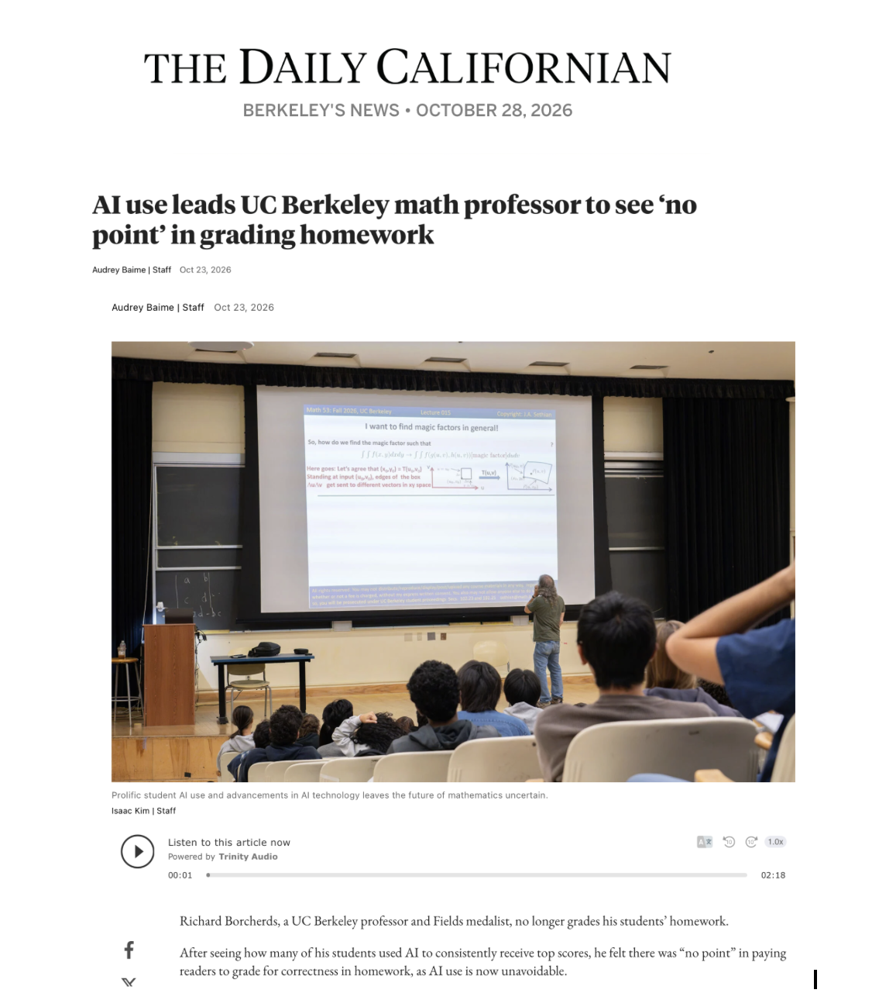{.shot fig-alt="Daily Californian article: AI use leads UC Berkeley math professor to see no point in grading homework"}
:::

::: {.column width="55%"}
::: {.statement-2}
Richard Borcherds, a Fields medalist on the Berkeley mathematics faculty, no longer grades homework for correctness.
:::

- Many of his students were using AI to receive top homework scores
- AI tools can now do much of the routine work in a course, and in many jobs
:::
::::

::: {.bottom-question}
If AI can produce the routine answers, what is left for you to learn?
:::

[Audrey Baime, *The Daily Californian*, October 23, 2026]{.caption}

::: notes
- Not a criticism of Borcherds; a reasonable response
- Same question applies to entry-level analytics work
- 1 min
:::

## Skills that keep their value

::: {.cards}
:::: {.columns}
::: {.column}
### Read and write Python

AI tools produce code that you have to check.
:::
::: {.column}
### Ask an inferential question

Is the goal prediction, or cause and effect?
:::
::: {.column}
### Debug and test

AI-generated code often fails without an error message.
:::
::: {.column}
### Know the domain

Economics or business knowledge is what makes a result meaningful.
:::
::::
:::

::: {.bottom-question}
Students who combine domain knowledge, data skills and working fluency with AI tools can build applications others cannot.
:::

::: notes
- Example of silent failure: a join that drops rows, then a model that looks fine
- Domain example: a backtest only makes sense if you know about transaction costs
- [VERIFY: any claim about employer demand for Python or AI skills before adding a number or source]
- 2 min
:::

## There is more analysis to do, not less

:::: {.columns}
::: {.column width="46%"}
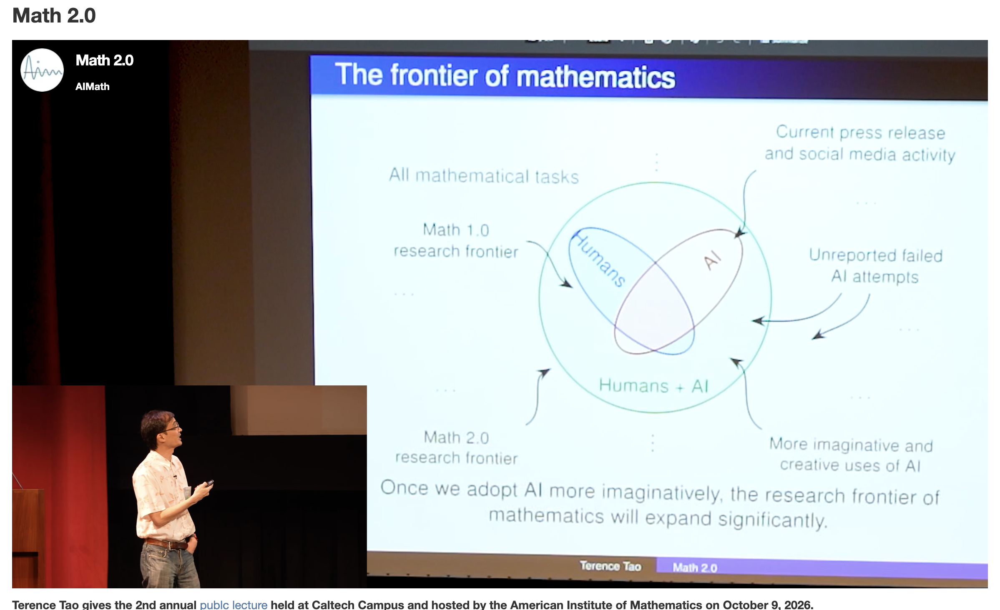{.shot fig-alt="Terence Tao, Math 2.0, Caltech, October 2026"}

[Terence Tao, "[Math 2.0](https://teorth.github.io/tao-web/slides/math-2-0-caltech-2026.pdf)," AIM Public Lecture, Caltech, October 2026]{.caption}
:::

::: {.column width="54%"}
::: {.statement-2}
"The future frontiers of mathematics will always continue to expand."
:::

The same may hold for analytics:

- Questions that took a semester project can now take a week
- Smaller teams can work on more questions
- More questions become feasible, in more fields
:::
::::

::: notes
- Tao: "era of proof abundance"; the frontier moves outward
- Tao keeps human understanding at the center
- Hedge: this is a view, not a forecast of hiring
- 1.5 min
:::

## Part 3 {.section-dark background-color="#061436"}

Step one: vibecoding

## What vibecoding means

:::: {.columns}
::: {.column width="50%"}
Vibecoding is describing an analysis in natural language and having an AI assistant write the code. You then run it, read it and revise it.

- Fast for a first draft
- The analyst is still responsible for the result
:::

::: {.column width="50%"}
::: {.flow .flow-navy}
- Describe the question
- Generate code
- Run it
- Read and check it
- Revise
:::
:::
::::

::: {.bottom-question}
How do you know the code is right?
:::

::: notes
- Term from Andrej Karpathy, February 2025
- Tools: Colab's built-in assistant, Copilot, Claude, ChatGPT
- Reading the code is the step people skip
:::

## Exercise: can we reproduce this chart? {.profile-slide}

:::: {.columns}
::: {.column width="45%"}
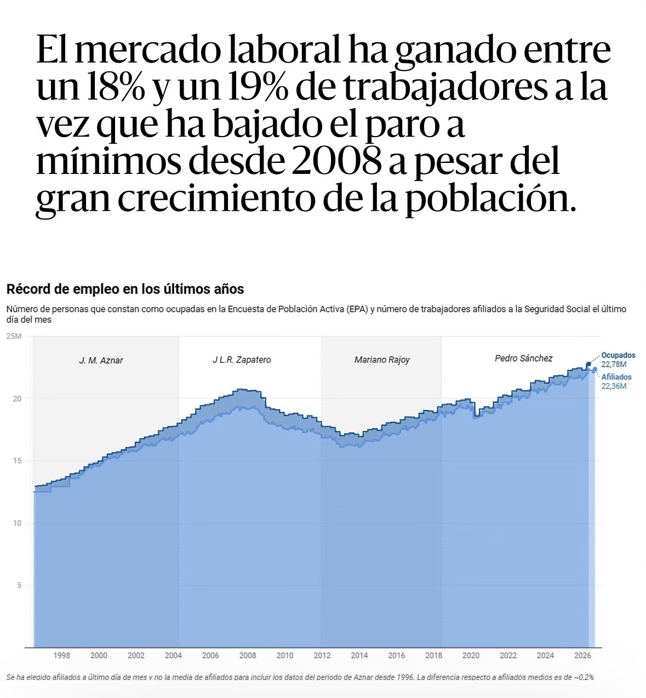{.shot fig-alt="Spanish news graphic: headline says the labor market has gained 18 to 19 percent more workers while unemployment fell to its lowest since 2008; area chart of employed persons (EPA) and Social Security affiliates from 1996 to 2026, shaded by the terms of Aznar, Zapatero, Rajoy and Sánchez"}
:::

::: {.column width="55%"}
- A chart of employment in Spain by presidential term, published in the press
- Two series: employed persons in the EPA survey and workers registered with Social Security
- The task for an AI assistant: find the data, rebuild the chart and check the headline
:::
::::

::: {.bottom-question}
The question is about data and careful reading, not about politics.
:::

[El Diario, Instagram post. [instagram.com/p/DeXZ-VrGlI6](https://www.instagram.com/p/DeXZ-VrGlI6/)]{.caption}

::: notes
- Used in the Madrid workshop, November 2026
- Headline: 18 to 19% more workers, unemployment lowest since 2008
- Footnote on chart: affiliates measured on the last day of the month
- Good vibecoding task: clear target, public data, easy to check by eye
:::

## The result in a notebook

:::: {.columns}
::: {.column width="60%"}
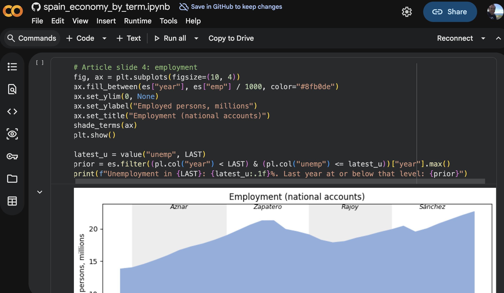{.shot fig-alt="spain_economy_by_term.ipynb open in Google Colab, with a code cell that plots employment, and the resulting chart shaded by the terms of Aznar, Zapatero, Rajoy and Sánchez"}
:::

::: {.column width="40%"}
- The rebuilt chart, shaded by each Spanish president's term
- Runs in Google Colab with a Google account
- Every step is in the notebook and can be checked
:::
::::

::: notes
- Point out the code cell above the chart
- Compare with the published chart: do the levels match?
:::

## A larger example: the vibecession notebook {.lite-slide}

:::: {.columns}
::: {.column width="62%"}
A notebook series built for students in Bogotá, October 2026, each running in Google Colab or JupyterLite.

- Sources data from public APIs
- Builds a monthly dataset
- Compares consumer sentiment with economic fundamentals
- Fits a time series model and examines the gap
:::

::: {.column width="38%" .lite-qr}
{fig-alt="QR code linking to the Colombia-26-NB notebook repository"}

[github.com/ericvd-ucb/Colombia-26-NB](https://github.com/ericvd-ucb/Colombia-26-NB)
:::
::::

::: notes
- US and Colombian vibecessions
- Colombia: OLS from inflation, unemployment, interbank rate, exchange rate, stock index, trained 2007 to 2019
- After 2020, actual confidence above the model in 62 of 64 months
- Interpreting it needs knowledge of Colombia: the peso, the 2021 national strike
:::

## Checking AI-written code with tests

:::: {.columns}
::: {.column width="45%"}
- Tests are written into the notebook
- A test checks what the code returns, not what it is called
- Here a function named `square` actually cubes its input
- Tests are how you check vibecoded work
:::

::: {.column width="55%"}
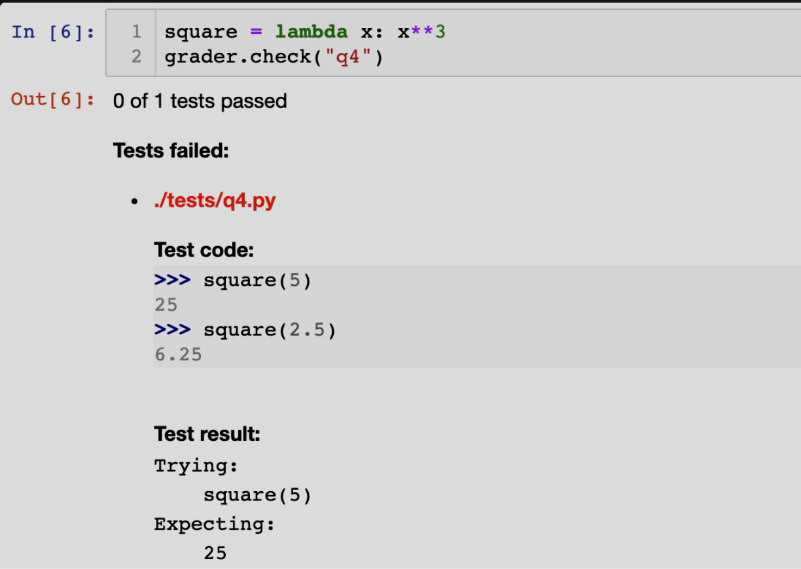{.shot fig-alt="Notebook cell running grader.check on question 4: a function named square that cubes its input fails the test, which shows the test code and the expected value of 25 for square(5)"}
:::
::::

[otter-grader: otter-grader.readthedocs.io]{.caption}

::: notes
- On screen: x**3 for square; grader.check("q4") shows the expected 25
- Berkeley courses use otter-grader, open source
- Ask the assistant to write tests too, then read them
:::

## Part 4 {.section-dark background-color="#061436"}

Step two: small models and the harness

## Small open models as teaching tools

:::: {.columns}
::: {.column width="42%"}
A small open model runs on a laptop or in a browser, so students can inspect it directly.

- Tokens and next-token probabilities
- Temperature and other settings
- The data that goes in and comes out
:::

::: {.column width="58%"}
```{.python code-line-numbers="false"}
from transformers import AutoTokenizer
from transformers import AutoModelForCausalLM

name = "HuggingFaceTB/SmolLM2-135M"  # 270 MB
tok = AutoTokenizer.from_pretrained(name)
lm = AutoModelForCausalLM.from_pretrained(name)

prompt = "The stock market is"
ids = tok(prompt, return_tensors="pt")
probs = lm(**ids).logits[0, -1].softmax(-1)
for p, i in zip(*probs.topk(5)):
    print(tok.decode(i), f"{p:.0%}")
```

{.center-logo fig-alt="Hugging Face, Ollama, and Jupyter logos combined"}
:::
::::

::: notes
- Many experiments do not need a frontier model
- Open weights: free to download, no API key
- 1.5 min
:::

## A small model in a notebook

:::: {.columns}
::: {.column width="58%"}
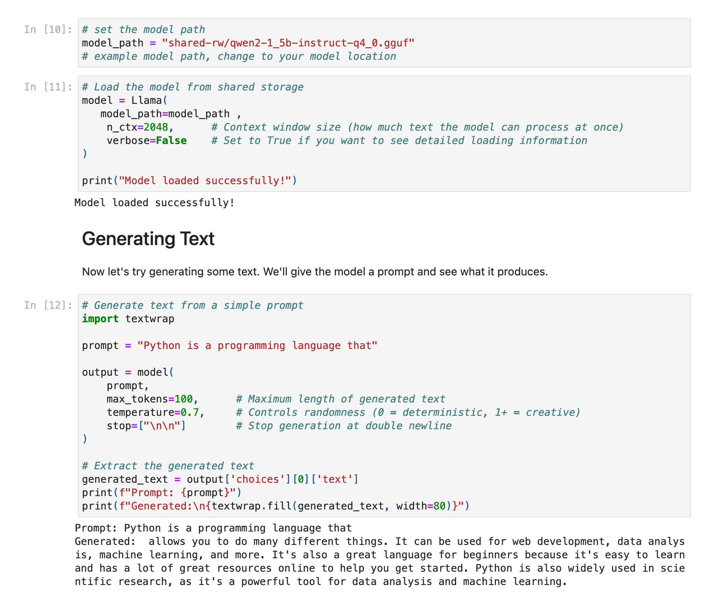{.shot fig-alt="Jupyter notebook loading a small Qwen model from a local file and generating text"}
:::

::: {.column width="42%"}
A small Qwen model loaded on a JupyterHub. Students load it, change parameters and observe the results, with no setup.

- Administrator: sets up the environment
- Instructor: sets up the curriculum
- Student: explores
:::
::::

::: notes
- Model stored in a shared folder on the hub
- Same roles as for Data 8 on DataHub
:::

## What a harness is

::: {.statement-2}
Products like ChatGPT or Claude are a model plus a harness around it. A small model makes each layer visible.
:::

::: {.chips .three}
- Tokens: text becomes numbers
- Chat format: system, user and assistant roles
- System prompt and settings such as temperature
- Context and memory: what the model sees each turn
- Tools: letting the model call code or search
- Evaluation: testing outputs for accuracy and bias
:::

::: notes
- Maps to the small-models-lite notebook series: starter sampler, model cards, chat format, tokens, memory, SAT test taker
- These are the concepts behind AI products students will use and build at work
- 2 min
:::

## Small models in the browser {.lite-slide}

:::: {.columns}
::: {.column width="34%" .lite-qr}
{fig-alt="QR code linking to the Small Models in the Browser site"}

**Try it on your laptop**

[ericvd-ucb.github.io/small-models-lite](https://ericvd-ucb.github.io/small-models-lite/)
:::

::: {.column width="66%"}
{.lite-logo fig-alt="JupyterLite"}

A JupyterLite site where small language models run in the student's browser through WebLLM, with no server, API key or installation.

- Talking to models and generation settings
- Tokens, chunking and embeddings
- Memory with SQLite and embedding search
- Inside an open-weight model package

[Requires Chrome or Edge with WebGPU.]{.caption .left}
:::
::::

::: notes
- Live demo if wifi allows; have fallback screenshots
- First model download takes a few minutes, then it is cached
- Thanks to Jeremy Tuloup and the JupyterLite community
:::

## A new course: Understanding AI with small models

::: {.statement-2}
Data 88I, a 2-unit connector course in development at Berkeley.
:::

- Runs in JupyterLite, on JupyterHub, or with students' own Ollama installation
- Topics: bias, evaluation, training data, privacy and API costs
- Built on the same notebooks as the small-models-lite site

::: notes
- In development; do not give a start term unless confirmed
- [VERIFY: course number, units and status before the talk]
:::

## Where to start

::: {.cards}
:::: {.columns}
::: {.column .lite-qr}
### 1. Open a notebook

[inferentialthinking.com](https://inferentialthinking.com)

Read the Data 8 textbook, then open a notebook in Google Colab.
:::
::: {.column .lite-qr}
### 2. Rebuild a chart

{fig-alt="QR code linking to the Colombia-26-NB notebook repository"}

Rebuild one chart with an AI assistant, and check the code.
:::
::: {.column .lite-qr}
### 3. Run a small model

{fig-alt="QR code linking to the Small Models in the Browser site"}

Run a small model and look at its tokens.
:::
::: {.column .lite-qr}
### 4. Try AI in JupyterLite

{fig-alt="QR code linking to the JupyterLite AI demo"}

An AI assistant inside a browser notebook.
:::
::::
:::

::: notes
- Leave this slide up during questions
:::

## Thank you {.center}

::: {.statement}
Eric Van Dusen<br>
College of Computing, Data Science, and Society, UC Berkeley
:::

[ericvd@berkeley.edu · [github.com/ericvd-ucb](https://github.com/ericvd-ucb)]{.caption}

::: notes
- Questions
:::
